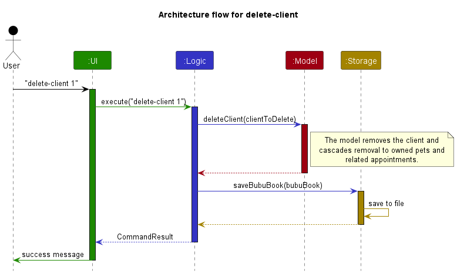
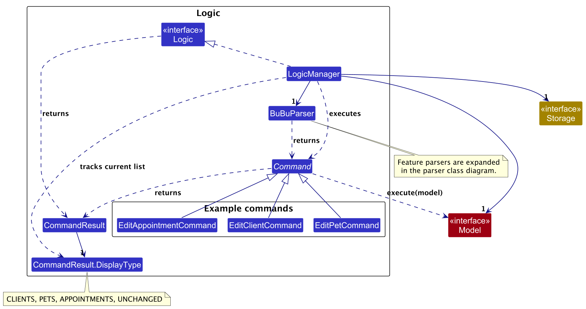
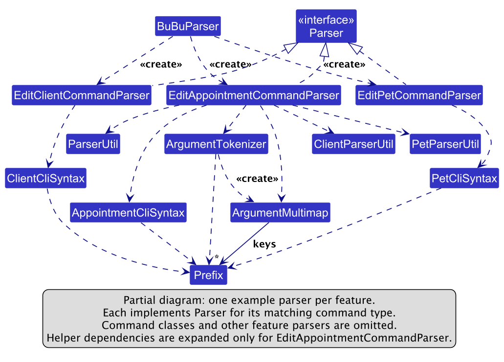
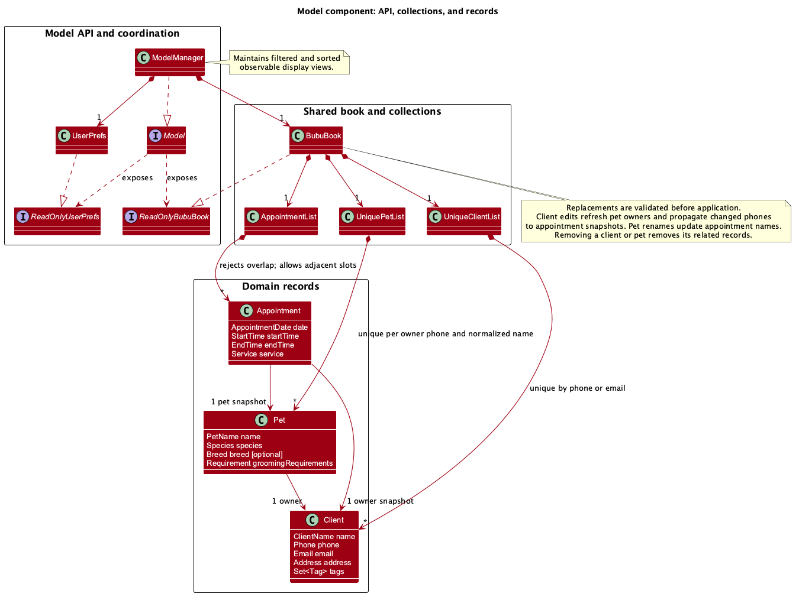
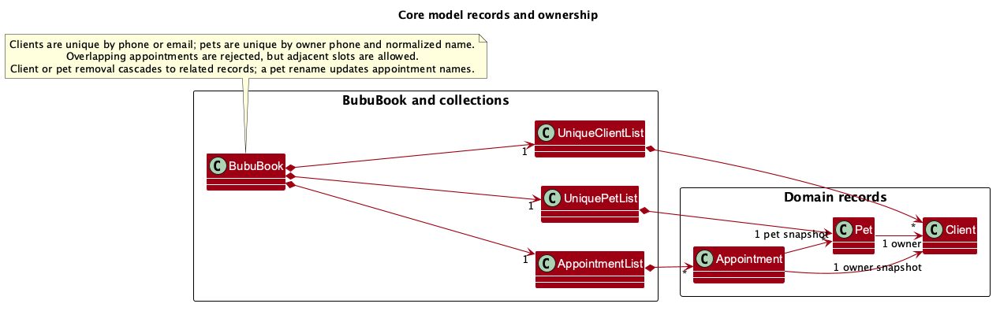
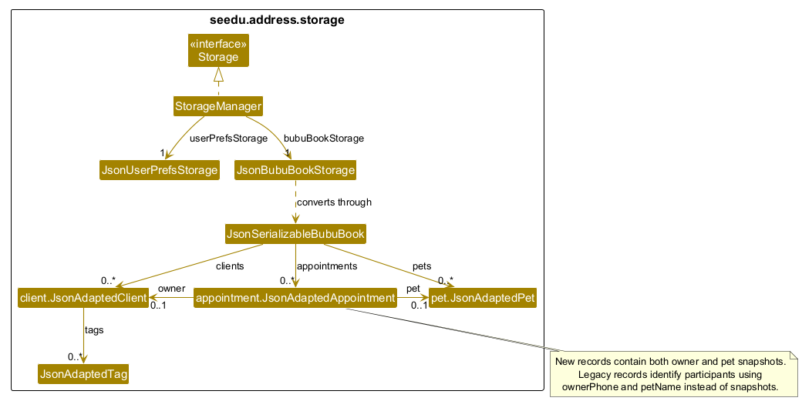

* Table of Contents
{:toc}

--------------------------------------------------------------------------------------------------------------------

## **Acknowledgements**

* _{List the sources of reused or adapted ideas, code, documentation, and third-party libraries here, with links to the originals.}_

--------------------------------------------------------------------------------------------------------------------

## **Setting up, getting started**

Refer to the guide [_Setting up and getting started_](SettingUp.md).

--------------------------------------------------------------------------------------------------------------------

## **Design**

:bulb: **Tip:** The `.puml` files used to create diagrams are in `docs/diagrams`. Refer to the [_PlantUML Tutorial_ at se-edu/guides](https://se-education.org/guides/tutorials/plantUml.html) to learn how to create and edit diagrams.

### Current code organization

`ModelManager` owns one `GroomingBook`, which contains clients, pets, and the appointment schedule.
Consumers read it through `ReadOnlyGroomingBook` and `Model.getGroomingBook()`.
`Client` replaces the inherited `Person` type. `UniqueClientList`, `UniquePetList`, and
`AppointmentList` enforce the rules for each collection inside the shared book.

| Responsibility | Package under `seedu.address` |
| --- | --- |
| Shared model and preferences | `model` |
| Client, pet, and appointment records | `model.client`, `model.pet`, `model.appointment` |
| Feature commands | `logic.commands.client`, `logic.commands.pet`, `logic.commands.appointment` |
| Feature parsers and CLI prefixes | `logic.parser.client`, `logic.parser.pet`, `logic.parser.appointment` |
| Shared tokenization and command routing | `logic.parser` (`BuBuParser`) |
| JSON record adapters | `storage.client`, `storage.pet`, `storage.appointment` |
| Client, pet, and appointment cards and list panels | `ui.client`, `ui.pet`, `ui.appointment` |

Tests mirror these feature packages. Shared parsing utilities stay in `logic.parser.ParserUtil`;
client and pet field parsing lives in `ClientParserUtil` and `PetParserUtil` respectively.
`AddAppointmentCommand` and `AddAppointmentCommandParser` handle the `add-appointment` command.
`ListPetsCommand` and `ListAppointmentsCommand` prepare the corresponding filtered views.
`DeletePetCommand` and `DeleteAppointmentCommand` accept either a one-based displayed index or an identifier form;
appointment deletion also accepts a date/time pair.

Replacing the grooming book validates all collections before changing existing records and keeps
observable list views connected to the model. Client edits update linked pet owners.
The `clear` command removes all clients, pets, and appointments, including historical bookings.

All clients, pets, and appointments are saved together in `data/groombook.json` through
`JsonGroomingBookStorage`. The JSON contains `clients`, `pets`, and `appointments` lists.
`preferences.json` remains separate for window settings. The former `addressbook.json` and
`appointments.json` files are no longer read or written; there is no automatic migration.

`list-pets` and `list-appointments` read records without saving; record-changing commands save the shared book. Saving writes a temporary file before replacing
the previous file. If saving fails, the previous in-memory book is restored. Unreadable data blocks
commands so the saved file cannot be overwritten with an empty book.

### Architecture

The ***Architecture Diagram*** given above explains the high-level design of the App.

The following provides a quick overview of the main components and their interactions.

**Main components of the architecture**

**`Main`** (consisting of classes [`Main`](https://github.com/se-edu/addressbook-level3/tree/master/src/main/java/seedu/address/Main.java) and [`MainApp`](https://github.com/se-edu/addressbook-level3/tree/master/src/main/java/seedu/address/MainApp.java)) is in charge of the app launch and shut down.
* At app launch, it initializes the other components in the correct sequence, and connects them up with each other.
* At shut down, it shuts down the other components and invokes cleanup methods where necessary.

The bulk of the app's work is done by the following four components:

* [**`UI`**](#ui-component): The UI of the App.
* [**`Logic`**](#logic-component): The command executor.
* [**`Model`**](#model-component): Holds the data of the App in memory.
* [**`Storage`**](#storage-component): Reads data from, and writes data to, the hard disk.

[**`Commons`**](#common-classes) represents a collection of classes used by multiple other components.

**How the architecture components interact with each other**

The *Sequence Diagram* below shows how the components interact with each other for the scenario where the user issues the command `delete-client 1`.

Each of the four main components (also shown in the diagram above),

* defines its *API* in an `interface` with the same name as the Component.
* provides its functionality through a concrete `{Component Name}Manager` class that implements the corresponding API interface.

For example, the `Logic` component defines its API in `Logic.java` and implements it in `LogicManager.java`. Other components interact with a component through its interface rather than its concrete class, preventing them from coupling to that component's implementation, as illustrated in the following partial class diagram.

The sections below give more details of each component.

### UI component

The **API** of this component is specified in [`Ui.java`](https://github.com/se-edu/addressbook-level3/tree/master/src/main/java/seedu/address/ui/Ui.java)

The UI consists of a `MainWindow` and its parts, such as `CommandBox`, `ResultDisplay`, `ClientListPanel`,
`PetListPanel`, `AppointmentListPanel`, and `StatusBarFooter`. All of these, including `MainWindow`, inherit from
the abstract `UiPart` class, which captures common behavior among classes that represent visible GUI parts.

The `UI` component uses the JavaFX UI framework. The layouts of these UI parts are defined in matching `.fxml` files in `src/main/resources/view`. For example, [`MainWindow.fxml`](https://github.com/se-edu/addressbook-level3/tree/master/src/main/resources/view/MainWindow.fxml) specifies the layout of [`MainWindow`](https://github.com/se-edu/addressbook-level3/tree/master/src/main/java/seedu/address/ui/MainWindow.java).

The `UI` component,

* executes user commands using the `Logic` component.
* listens for changes to `Model` data so that the UI can be updated with the modified data.
* keeps a reference to the `Logic` component, because the `UI` relies on the `Logic` to execute commands.
* depends on `Client`, `Pet`, and `Appointment` classes from the `Model` component because its three list panels
  display those records.

`MainWindow` creates all three list panels once and keeps them bound to the model's observable lists. It shows exactly
one panel at a time using the `DisplayType` carried by `CommandResult`: `CLIENTS`, `PETS`, or `APPOINTMENTS`.
Successful list commands set this value, and commands that do not change the selected record type use
`UNCHANGED`. Hidden panels are also unmanaged so that they do not occupy layout space.

The `help` command returns the command reference stored in
`src/main/resources/help/CommandReference.md`. `MainWindow` displays this result in
`ResultDisplay`, which renders command names and command formats with distinct styles in a scrollable inline view.
The **Help** menu item and <kbd>F1</kbd> invoke the same command. When adding or changing a command, keep this
reference in sync with the User Guide.

### Logic component

**API** : [`Logic.java`](https://github.com/se-edu/addressbook-level3/tree/master/src/main/java/seedu/address/logic/Logic.java)

Here's a (partial) class diagram of the `Logic` component:

The sequence diagram below illustrates the interactions within the `Logic` component, taking `execute("delete-client 1")` API call as an example.

:information_source: **Note:** The lifeline for `DeleteClientCommandParser` should end at the destroy marker (X), but due to a limitation of PlantUML, it continues to the end of the diagram.

How the `Logic` component works:

1. When `Logic` is called upon to execute a command, the command is passed to a `BuBuParser` object, which in turn creates a parser that matches the command (e.g., `DeleteClientCommandParser`) and uses it to parse the command.
2. This results in a `Command` object (more precisely, an object of one of its subclasses e.g., `DeleteClientCommand`) which is executed by the `LogicManager`.
3. The command can communicate with the `Model` when it is executed (e.g. to delete a client, pet, or appointment). 
   Note that although this is shown as a single step in the diagram above for simplicity, the code can require several interactions between the command object and the `Model` to complete the operation.
4. The result of the command execution is encapsulated as a `CommandResult` object which is returned from `Logic`.

Here are the other classes in `Logic` (omitted from the class diagram above) that are used for parsing a user command:

How the parsing works:
* When called upon to parse a user command, the `BuBuParser` class creates an `XYZCommandParser` (`XYZ` is a placeholder for the specific command name, e.g., `AddClientCommandParser`). The parser uses the other classes shown above to parse the user command and create an `XYZCommand` object (e.g., `AddClientCommand`). The `BuBuParser` returns that object as a `Command` object.
* All `XYZCommandParser` classes, such as `AddClientCommandParser` and `DeleteClientCommandParser`, implement the `Parser` interface so they can be treated similarly where appropriate, for example during testing.

Index-based commands accept exactly one positive integer index:

* `delete-client INDEX` uses the currently displayed client list.
* `delete-pet INDEX` uses the currently displayed pet list.
* `delete-appointment INDEX` uses the currently displayed ongoing/future appointment list.
* Identifier forms such as `delete-client i/PHONE_NUMBER` and `delete-pet p/PET_NAME i/OWNER_IDENTIFIER`
  search the saved grooming book instead of relying on the displayed list.

`LogicManager` tracks the current `DisplayType` and rejects an index-based deletion when the corresponding record
list is not displayed. This prevents a deletion index from being interpreted against a different record type.

### Model component
**API** : [`Model.java`](https://github.com/se-edu/addressbook-level3/tree/master/src/main/java/seedu/address/model/Model.java)

The `Model` component,

* stores clients in `UniqueClientList`, pets in `UniquePetList`, and appointments in `AppointmentList` inside one
  `GroomingBook`.
* represents each `Pet` using a name, owner, species, optional breed, and grooming requirement. A pet holds a reference
  to its owning `Client`; when a client is replaced, any pets owned by that client are updated to reference the replacement.
* rejects duplicate clients and duplicate pet names for the same owner. `AppointmentList` rejects any appointment that
  overlaps an existing appointment, while allowing back-to-back appointments and retaining historical appointments.
* maintains filtered views for clients, pets, and appointments. `ModelManager` exposes each view as an unmodifiable,
  observable list backed by a `SortedList`, so the UI updates automatically when records or predicates change.
* orders pets by owner name (case-insensitive), owner phone number, and normalized pet name. It orders appointments by
  date and start time. The saved list order in `GroomingBook` is not changed by these display orderings.
* stores a `UserPrefs` object that represents the user’s preferences (currently, just the GUI settings). This is exposed to the outside as a `ReadOnlyUserPrefs` object.
* does not depend on any of the other three components (as the `Model` represents data entities of the domain, they should make sense on their own without depending on other components)

:information_source: **Note:** The alternative, arguably more object-oriented, design below keeps a unique list of tags in `AddressBook`, and each `Person` references tags from that list. This lets `AddressBook` maintain one `Tag` object per unique tag instead of each `Person` holding its own `Tag` objects. 

### Storage component

**API** : [`Storage.java`](https://github.com/se-edu/addressbook-level3/tree/master/src/main/java/seedu/address/storage/Storage.java)

The `Storage` component:

* saves the complete grooming book in `data/groombook.json`, with user preferences in `preferences.json`.
* is implemented by `StorageManager`, which delegates to `JsonGroomingBookStorage` and `JsonUserPrefsStorage`.
* uses `JsonSerializableGroomingBook` to load and save the three record lists together.
* uses `JsonAdaptedClient`, `JsonAdaptedPet`, and `JsonAdaptedAppointment` in their respective feature packages.
  A saved pet records its owner's name and phone, plus an optional breed. Loading resolves the owner by phone
  when available, or by name for records without a phone.

#### Appointment persistence

Appointments belong to the shared `GroomingBook` and are saved in the same file as clients and pets.
`JsonAdaptedAppointment` converts the phone, pet name, date, times, and service into JSON fields and back.
Loading accepts historical appointments and rejects invalid or overlapping records.

The scheduling flow is `AddAppointmentCommand` → `GroomingBook` → `StorageManager` → `data/groombook.json`.
The deletion flow is `DeleteAppointmentCommand` → `ModelManager.deleteAppointment()` →
`GroomingBook.removeAppointment()` → `AppointmentList.removeAppointment()`.
`LogicManager` reports success only after saving. If saving fails, it restores the previous book and reports
an error. `clear` removes all clients, pets, and appointments, including historical and future bookings,
and saves the empty grooming book in the same file.

At startup, `MainApp` loads the complete book once. A missing file starts with sample clients and an empty
schedule. An invalid file produces a log warning and an empty model; commands are blocked to preserve the file.

The default app parser enables scheduling directly. `AddAppointmentCommand` checks the complete saved client
and pet lists at execution time, independently of display filters. The owner phone must identify a registered
client, and the pet must belong to that owner. Pet matching uses `PetName.getNormalizedName()` so case and
repeated whitespace do not affect identity. Appointments use the shared `PetName` value type while JSON still
stores names as strings. Historical appointments can load even after their client or pet has been removed.
The full create-client, create-pet, schedule, save, and restart flow is tested through the default parser.

### Common classes

Classes used by multiple components are in the `seedu.address.commons` package.

--------------------------------------------------------------------------------------------------------------------

## **Implementation**

This section describes some noteworthy details on how certain features are implemented.

### \[Proposed\] Undo/redo feature

#### Proposed Implementation

The proposed undo/redo mechanism is facilitated by `VersionedAddressBook`. It extends `AddressBook` with an undo/redo history, stored internally as an `addressBookStateList` and `currentStatePointer`. Additionally, it implements the following operations:

* `VersionedAddressBook#commit()` — Saves the current address book state in its history.
* `VersionedAddressBook#undo()` — Restores the previous address book state from its history.
* `VersionedAddressBook#redo()` — Restores a previously undone address book state from its history.

These operations are exposed in the `Model` interface as `Model#commitAddressBook()`, `Model#undoAddressBook()` and `Model#redoAddressBook()` respectively.

Given below is an example usage scenario and how the undo/redo mechanism behaves at each step.

Step 1. The user launches the application for the first time. The `VersionedAddressBook` will be initialized with the initial address book state, and the `currentStatePointer` pointing to that single address book state.

Step 2. The user executes `delete-client 5` command to delete the 5th person in the address book. The `delete-client` command calls `Model#commitAddressBook()`, causing the modified state of the address book after the `delete-client 5` command executes to be saved in the `addressBookStateList`, and the `currentStatePointer` is shifted to the newly inserted address book state.

Step 3. The user executes `add n/David …​` to add a new person. The `add` command also calls `Model#commitAddressBook()`, causing another modified address book state to be saved into the `addressBookStateList`.

:information_source: **Note:** If a command fails its execution, it will not call `Model#commitAddressBook()`, so the address book state will not be saved into the `addressBookStateList`.

Step 4. The user now decides that adding the person was a mistake, and decides to undo that action by executing the `undo` command. The `undo` command will call `Model#undoAddressBook()`, which will shift the `currentStatePointer` once to the left, pointing it to the previous address book state, and restores the address book to that state.

:information_source: **Note:** If the `currentStatePointer` is at index 0, pointing to the initial AddressBook state, then there are no previous AddressBook states to restore. The `undo` command uses `Model#canUndoAddressBook()` to check if this is the case. If so, it will return an error to the user rather
than attempting to perform the undo.

The following sequence diagram shows how an undo operation goes through the `Logic` component:

:information_source: **Note:** The lifeline for `UndoCommand` should end at the destroy marker (X), but due to a limitation of PlantUML, it continues to the end of the diagram.

Similarly, how an undo operation goes through the `Model` component is shown below:

The `redo` command does the opposite — it calls `Model#redoAddressBook()`, which shifts the `currentStatePointer` once to the right, pointing to the previously undone state, and restores the address book to that state.

:information_source: **Note:** If the `currentStatePointer` is at index `addressBookStateList.size() - 1`, pointing to the latest address book state, then there are no undone AddressBook states to restore. The `redo` command uses `Model#canRedoAddressBook()` to check if this is the case. If so, it will return an error to the user rather than attempting to perform the redo.

Step 5. The user then decides to execute the command `list`. Commands that do not modify the address book, such as `list`, will usually not call `Model#commitAddressBook()`, `Model#undoAddressBook()` or `Model#redoAddressBook()`. Thus, the `addressBookStateList` remains unchanged.

Step 6. The user executes `clear`, which calls `Model#commitAddressBook()`. Since the `currentStatePointer` is not pointing at the end of the `addressBookStateList`, all address book states after the `currentStatePointer` will be purged. Reason: It no longer makes sense to redo the `add n/David …​` command. This is the behavior that most modern desktop applications follow.

The following activity diagram summarizes what happens when a user executes a new command:

#### Design considerations:

**Aspect: How undo & redo execute:**

* **Alternative 1 (current choice):** Saves the entire address book.
  * Pros: Easy to implement.
  * Cons: May have performance issues in terms of memory usage.

* **Alternative 2:** Individual command knows how to undo/redo by
  itself.
  * Pros: Will use less memory (e.g. for `delete-client`, just save the person being deleted).
  * Cons: We must ensure that the implementation of each individual command is correct.

_{more aspects and alternatives to be added}_

### \[Proposed\] Data archiving

_{Explain here how the data archiving feature will be implemented}_

--------------------------------------------------------------------------------------------------------------------

## **Documentation, logging, testing, dev-ops**

* [Documentation guide](Documentation.md)
* [Testing guide](Testing.md)
* [Logging guide](Logging.md)
* [DevOps guide](DevOps.md)

--------------------------------------------------------------------------------------------------------------------

## **Appendix: Requirements**

### Product scope

**Target user profile**:

* freelance mobile pet groomer
* manages a significant number of contacts, appointments and pet care requirements
* prefers desktop apps over other types of applications
* can type fast
* prefers typing to mouse interactions
* is reasonably comfortable using CLI apps

**Value proposition**: Manage contacts, track grooming preferences and care requirements,
and schedule upcoming appointments faster than with a typical mouse-driven GUI application.

### User stories

Priorities: High (must have) - `* * *`, Medium (nice to have) - `* *`, Low (unlikely to have) - `*`

| Priority | As a …​                                    | I want to …​                                                    | So that I can…​                                                                |
| -------- | ------------------------------------------ | --------------------------------------------------------------- | ------------------------------------------------------------------------------ |
| `* * *`  | new user                                   | see usage instructions                                          | refer to instructions when I forget how to use the App                         |
| `* * *`  | mobile pet groomer                         | add a new client and their pet’s basic information              | start building my digital roster                                               |
| `* * *`  | mobile pet groomer                         | list all pets or one client's pets                               | review their care requirements before a visit                                  |
| `* * *`  | user                                       | add a new person                                                |                                                                                |
| `* * *`  | user                                       | find a person by name                                           | locate details of persons without having to go through the entire list         |
| `* * *`  | mobile pet groomer                         | book a single grooming appointment on a specific date           | get a new job on my calendar                                                   |
| `* * *`  | mobile pet groomer                         | easily find the address for my next appointment                 | know exactly where to drive                                                    |
| `* * *`  | user                                       | delete a person                                                 | remove entries that I no longer need                                           |
| `* * *`  | user                                       | delete a pet using its name and owner's phone number            | remove pet records that I no longer need                                      |
| `* *`    | mobile pet groomer                         | find timeslots that are empty                                   | fit in new jobs into my busy schedule easily                                   |
| `* *`    | mobile pet groomer                         | make changes to my upcoming appointments easily                 |                                                                                |
| `* *`    | mobile pet groomer                         | mark an appointment as completed                                | easily distinguish finished jobs from pending visits on my daily schedule      |
| `* *`    | user                                       | hide private contact details                                    | minimize chance of someone else seeing them by accident                        |
| `*`      | mobile pet groomer                         | tag behavioral quirks (e.g., cage-anxious, nipper, hyperactive) | prepare safety gear and allocate handling time appropriately                   |
| `*`      | mobile pet groomer                         | add custom labels to clients (e.g., VIP, prefers-weekends)      | quickly filter and manage my customer base based on specific business criteria |
| `*`      | user with many persons in the address book | sort persons by name                                            | locate a person easily                                                         |

*{More to be added}*

### Use cases

**System:** BuBu

**Use case:** UC1 - Add a client and their pet

**Actor:** Groomer

**Preconditions:** -

**Guarantees:**
- A client or pet is saved only if all of its details are valid.
- The pet is linked to the client it was added under.
- No two clients share the same phone number or email.

**MSS:**

1. Groomer requests to add a client, providing the client's name, phone number, email and address.
2. BuBu adds the client and shows a confirmation.
3. Groomer requests to add a pet under the client, providing the pet's name, species, optional breed and grooming requirements.
4. BuBu adds the pet under the client and shows a confirmation.
5. Groomer requests to view the client's pets.
6. BuBu shows the client's pets and their details.

Use case ends.

**Extensions:**

- 1a. BuBu detects a missing, repeated or invalid client detail.
    - 1a1. BuBu informs Groomer of the problem.
    - 1a2. Groomer enters the corrected details.
    - Steps 1a1-1a2 are repeated until the details are valid.
    - Use case resumes from step 2.
- 1b. The phone number or email already belongs to another client.
    - 1b1. BuBu informs Groomer that the client already exists.
    - 1b2. Groomer enters a different phone number or email.
    - Steps 1b1-1b2 are repeated until the phone number and email are unique.
    - Use case resumes from step 2.
- 3a. A pet detail is missing, repeated or invalid (e.g. unsupported species, requirements containing a slash).
    - 3b1. BuBu informs Groomer of the problem.
    - 3b2. Groomer enters the corrected details.
    - Steps 3b1-3b2 are repeated until the details are valid.
    - Use case resumes from step 4.
- 3b. The client already has a pet with the same name.
    - 3c1. BuBu informs Groomer of the duplicate.
    - Use case ends.

---

**System:** BuBu

**Use case:** UC2 - Book a grooming appointment

**Actor:** Groomer

**Preconditions:** The client and their pet are already saved.

**Guarantees:**

- The new appointment does not overlap any existing appointment.
- The appointment lies within working hours (08:00-20:00) and starts in the future.

**MSS:**

1. Groomer searches for the client.
2. BuBu shows the matching clients and their details.
3. Groomer requests to view the client's pets.
4. BuBu shows the pets and their care requirements.
5. Groomer requests to view the appointments on the intended date.
6. BuBu shows the appointments on that date.
7. Groomer requests to schedule an appointment for the pet, specifying the date, start time, end time and service.
8. BuBu adds the appointment, shows a confirmation and shows the updated appointment list.

Use case ends.

**Extensions:**

- 2a. No client matches the search.
    - 2a1. BuBu informs Groomer that no clients match.
    - 2a2. Groomer enters a different search keyword.
    - Steps 2a1-2a2 are repeated until a client is found.
    - Use case resumes from step 3.
- 5a. The date is not a valid date.
    - 5a1. BuBu informs Groomer of the problem.
    - 5a2. Groomer enters a corrected date.
    - Steps 5a1-5a2 are repeated until the date is valid.
    - Use case resumes from step 6.
- 6a. There are no appointments on that date.
    - 6a1. BuBu informs Groomer that nothing is scheduled.
    - Use case resumes from step 7.
- 7a. A scheduling detail is missing, repeated or invalid (e.g. past date, outside working hours, not on 30-minute intervals, end less than 30 minutes after start, unsupported service).
    - 7a1. BuBu informs Groomer of the problem.
    - 7a2. Groomer enters corrected details.
    - Steps 7a1-7a2 are repeated until the details are valid.
    - Use case resumes from step 8.
- 7b. The time slot overlaps an existing appointment.
    - 7b1. BuBu informs Groomer of the conflicting appointment's time.
    - 7b2. Groomer enters a different time slot.
    - Steps 7b1-7b2 are repeated until the slot is free.
    - Use case resumes from step 8.

---

**System:** BuBu

**Use case:** UC3 - Reschedule an appointment

**Actor:** Groomer

**Preconditions:** At least one upcoming appointment is saved in BuBu.

**Guarantees:**

- The old appointment is removed only after Groomer confirms.
- The new appointment does not overlap any existing appointment.

*BuBu has no edit feature, so rescheduling is a deletion followed by a new booking.*

**MSS:**

1. Groomer requests to view the appointments on the date of the appointment to be moved.
2. BuBu shows the appointments on that date.
3. Groomer requests to delete the appointment, identifying it by date and a time within it.
4. BuBu requests confirmation of the deletion.
5. Groomer confirms.
6. BuBu deletes the appointment and shows a confirmation.
7. Groomer requests to schedule the same pet for the new slot, specifying the date, start time, end time and service.
8. BuBu adds the appointment and shows a confirmation.

Use case ends.

**Extensions:**

- 1a. The date is not a valid date.
    - 1a1. BuBu informs Groomer of the problem.
    - 1a2. Groomer enters a corrected date.
    - Steps 1a1-1a2 are repeated until the date is valid.
    - Use case resumes from step 2.
- 2a. There are no appointments on that date.
    - 2a1. BuBu informs Groomer that nothing is scheduled.
    - 2a2. Groomer requests to view the appointments on a different date.
    - Steps 2a1-2a2 are repeated until a date with appointments is found.
    - Use case resumes from step 3.
- 3a. The date or time is invalid.
    - 3a1. BuBu informs Groomer that no matching appointment was found.
    - 3a2. Groomer enters a corrected date or time.
    - Steps 3a1-3a2 are repeated until an appointment is matched.
    - Use case resumes from step 4.
- 5a. Groomer cancels the deletion.
    - 5a1. BuBu leaves the schedule unchanged.
    - Use case ends.
- 7a. The new slot is invalid or overlaps another appointment.
    - 7a1. BuBu informs Groomer of the problem.
    - 7a2. Groomer enters a different slot.
    - Steps 7a1-7a2 are repeated until the slot is valid.
    - The original appointment remains deleted.
    - Use case resumes from step 8.2

---

**System:** BuBu

**Use case:** UC4 - Remove a client who has pets and appointments

**Actor:** Groomer

**Preconditions:** The client has at least one saved pet and one upcoming appointment saved in BuBu.

**Guarantees:**

- Nothing is deleted without Groomer's confirmation.
- A client is deleted only when no pets or appointments are linked to them.

**MSS:**

1. Groomer requests to view the upcoming appointments.
2. BuBu shows the upcoming appointments.
3. Groomer requests to delete the client's appointment.
4. BuBu requests confirmation.
5. Groomer confirms.
6. BuBu deletes the appointment and shows a confirmation.
7. Groomer requests to delete the client's pet.
8. BuBu requests confirmation.
9. Groomer confirms.
10. BuBu deletes the pet and shows a confirmation.
11. Groomer requests to delete the client.
12. BuBu requests confirmation.
13. Groomer confirms.
14. BuBu deletes the client and shows a confirmation.

Use case ends.

**Extensions:**

- 3a. The date or time is invalid.
    - 3a1. BuBu informs Groomer that no matching appointment was found.
    - 3a2. Groomer enters a corrected date or time.
    - Steps 3a1-3a2 are repeated until an appointment is matched.
    - Use case resumes from step 4.
- 5a. Groomer cancels the appointment deletion.
    - 5a1. BuBu leaves all further records unchanged.
    - Use case ends.
- 7a. The pet still has a future appointment.
    - 7a1. BuBu informs Groomer which appointment must be cancelled first.
    - Use case resumes from step 3.
- 9a. Groomer cancels the pet deletion.
    - 9a1. BuBu leaves all further records unchanged.
    - Use case ends.
- 11a. The client still has pets or appointments linked to them.
    - 11b1. BuBu informs Groomer which linked records remain.
    - Use case resumes from step 3 (if appointments remain) or step 7 (if only pets remain).
- 13a. Groomer cancels the client deletion.
    - 13a1. BuBu leaves all further records unchanged.
    - Use case ends.

---

**System:** BuBu

**Use case:** UC5 - Prepare for a day's appointments

**Actor:** Groomer

**Preconditions:** At least one client with at least one pet profile is saved in BuBu.

**MSS:**

1. Groomer requests to view the appointments on a given date.
2. BuBu shows the appointments in start-time order.
3. Groomer searches for the client of an appointment.
4. BuBu shows the client's phone number, email and address.
5. Groomer requests to view the client's pets.
6. BuBu shows the pets and their care requirements.

Steps 3-6 are repeated for each appointment on the date.

Use case ends.

**Extensions:**

- 1a. The date is not a valid date.
    - 1a1. BuBu informs Groomer of the problem.
    - 1a2. Groomer enters a corrected date.
    - Steps 1a1-1a2 are repeated until the date is valid.
    - Use case resumes from step 2.
- 2a. There are no appointments on that date.
    - 2a1. BuBu informs Groomer that nothing is scheduled.
    - Use case ends.
- 3a. No client matches the search.
    - 3b1. BuBu informs Groomer that no clients match.
    - 3b2. Groomer enters a different search keyword.
    - Steps 3b1-3b2 are repeated until the intended client is found.
    - Use case resumes from step 4.
**Use case: Delete a pet**

**MSS**

1.  User requests to delete a pet by providing the pet's name and its owner's phone number.
2.  AddressBook finds the pet matching both values.
3.  AddressBook deletes the pet.

    Use case ends.

**Extensions**

* 1a. The command format, pet name, or owner phone number is invalid.

    * 1a1. AddressBook shows an error message.

      Use case ends.

* 2a. No pet matches the given name and owner phone number.

    * 2a1. AddressBook shows an error message.

      Use case ends.

*{More to be added}*

### Non-Functional Requirements

1.  Should work on any _mainstream OS_ as long as it has Java `25` or above installed.
2.  Should be able to hold up to 1,000 total records (clients, pets, and appointments combined) and display schedules without noticeable sluggishness in performance.
3.  A user with above-average typing speed for regular English text (i.e. not code, not system admin commands) should be able to accomplish most of the tasks faster using commands than using the mouse.
4.  Should respond to any user command and refresh the interface display within 1 second during typical usage.
5.  Should not consume excessive memory, maintaining an active runtime memory footprint below 500 MB under normal operation.
6.  Should persist all data immediately to the local storage file upon the completion of each mutating command so that data is preserved in the event of an abrupt application exit or crash.
7.  Should be distributed as a single standalone executable JAR file and run without requiring an external installer, setup wizard, or administrative privileges.
8.  Should store all application data locally in a human-editable plain-text file without requiring an external database management system.
9.  Should operate completely offline without requiring an active internet connection, cloud services, or external server components.
10. Should be designed for a single user per instance, relying on the host operating system's user account security without managing separate in-app user accounts or access levels.
11. Should maintain atomic state updates such that any command that encounters a parsing or execution error leaves stored data completely unmodified.
12. Should start safely and inform the user if the local data file is missing, empty, or corrupted, rather than terminating unexpectedly.
13. Should remain fully functional and legible on standard laptop screen resolutions (1920x1080, 1440x900, 1366x768) across 13- to 16-inch displays without text truncation or horizontal scrolling.
14. Will not perform any background automated tasks (such as sending scheduled reminder messages or running background daemons) when the application is idle or closed.

### Glossary

* **Mainstream OS**: Windows, Linux, Unix, or macOS
* **JSON (JavaScript Object Notation)**: The lightweight, human-readable plain-text format used by BuBu for local persistent file storage.
* **CLI (Command Line Interface)**: A text-based user interface where the groomer issues discrete text commands to execute operations.
* **GUI (Graphical User Interface)**: The visual layout built with JavaFX that displays formatted client lists, pet profiles and schedule information.
* **Appointment**: A scheduled mobile grooming engagement linking a specific client and pet to a date, time, and care requirements.
* **Care Requirements**: Special notes, medical conditions, temperamental traits, behavioral warnings, or styling preferences associated with a pet.
* **Behavioral Quirks**: Custom tags attached to a pet profile indicating temperamental traits or handling considerations (e.g., `cage-anxious`, `nipper`, `hyperactive`) to help the groomer prepare appropriate equipment.
* **Client**: A pet owner profile containing  contact information, including name, phone number, email and home address.
* **Confirmation**: An explicit verification step required by BuBu before completing destructive actions (such as deletions) to avoid accidental data loss.
* **Groomer**: The primary user and actor of BuBu; an independent mobile pet groomer managing appointments, client contacts, and pet profiles on-the-go.
* **Pet Profile**: A distinct record belonging to a specific client that tracks the pet's name, species, optional breed, and care requirements.
* **Rescheduling**: The composite workflow of deleting an existing appointment followed by booking a new slot for the same pet.
* **Service**: A supported grooming option (e.g., full groom, basic bath, nail trim) assigned to an appointment.
* **Time Slot**: A continuous duration on a given date during which a grooming appointment takes place, constrained to 30-minute intervals within working hours.
* **Working Hours**: The allowable operating time frame within which appointments can be booked, defined in BuBu as 08:00 to 20:00.

--------------------------------------------------------------------------------------------------------------------

## **Appendix: Instructions for manual testing**

Given below are instructions to test the app manually.

:information_source: **Note:** These instructions only provide a starting point for testers to work on;
testers are expected to do more *exploratory* testing.

### Launch and shutdown

1. Initial launch

   1. Download the JAR file and copy it into an empty folder.

   2. Double-click the JAR file. 
      Expected: The GUI opens with a set of sample contacts. The window size may not be optimal.

2. Saving window preferences

   1. Resize the window to an optimal size. Move the window to a different location. Close the window.

   2. Relaunch the app by double-clicking the JAR file. 
       Expected: The most recent window size and location are retained.

3. _{ more test cases …​ }_

### Switching the displayed record list

1. Displaying each record type

   1. Test case: `list` 
      Expected: The client list is visible and the clients are shown in the result area/list panel.

   2. Test case: `list-pets` 
      Expected: The pet list replaces the client list in the GUI.

   3. Test case: `list-appointments` 
      Expected: The appointment list replaces the pet list and shows ongoing/future appointments in date and start-time order.

2. Rejecting an index for the wrong record type

   1. Prerequisites: The pet list is currently displayed and contains at least one pet.

   2. Test case: `delete-client 1` 
      Expected: No client is deleted. The status message is `The current displayed list does not match the record type selected by the index.`

   3. Test case: `delete-pet 1` 
      Expected: The first displayed pet is deleted.

   4. Prerequisites: The appointment list is currently displayed and contains at least one appointment.

   5. Test case: `delete-appointment 1` 
      Expected: The first displayed appointment is deleted.

### Deleting a person

1. Deleting by displayed index

   1. Prerequisites: List all persons using the `list` command, with multiple persons in the list.

   2. Test case: `delete-client 1` 
      Expected: The first person is deleted from the list. The status message shows the deleted person's details.

   3. Test case: `delete-client 0` 
      Expected: No person is deleted. The status message shows error details.

   4. Test case: `delete-client 999` 
      Expected: No person is deleted. The status message shows error details.

2. Deleting by phone number

   1. Prerequisites: A person with phone number `91234567` exists.

   2. Test case: `delete-client i/91234567` 
      Expected: The matching person is deleted. The status message shows the deleted person's details.

   3. Test case: `delete-client i/00000000` 
      Expected: No person is deleted because no matching person exists.

   4. Test case: `delete-client i/12` 
      Expected: No person is deleted because the phone number is invalid.

3. Invalid identifier combinations

   1. Test case: `delete-client` 
      Expected: The command is rejected because no identifier was provided.

   2. Test case: `delete-client 1 i/91234567` 
      Expected: The command is rejected because both identifiers were provided.

   3. Other incorrect delete commands to try: `delete-client x`, `delete-client i/abc` 
      Expected: Similar to previous.

4. _{ more test cases …​ }_

### Adding a pet

1. Adding pets with and without a breed

   1. Prerequisites: A client named `Alex Yeoh` with phone number `87438807` exists and has no pets named `Mochi` or `BuBu`.

   2. Test case: `add-pet p/Mochi i/87438807 s/Dog b/Golden retriever r/Nervous around dryers` 
      Expected: `Pet added: Mochi (Dog, Golden retriever) under Alex Yeoh.`

   3. Test case: `add-pet p/BuBu i/87438807 s/Cat r/Calm with baths` 
      Expected: `Pet added: BuBu (Cat) under Alex Yeoh.` Both pets remain saved under Alex Yeoh.

2. Rejecting a duplicate pet name

   1. Prerequisites: Alex Yeoh already has a pet named `Mochi`.

   2. Test case: `add-pet p/Mochi i/87438807 s/Dog r/Calm with baths` 
      Expected: The pet is not added; the status message is `This client already has a pet named Mochi.`

3. Invalid pet details and owner identifiers

   1. Prerequisites: Alex Yeoh (phone number `87438807`) exists.

   2. Test case: `add-pet p/Mochi i/87438807 s/Dog` 
      Expected: No pet is added. The status message is `Missing required field: REQUIREMENTS.`

   3. Test case: `add-pet p/Mochi i/87438807 s/Horse r/Calm with baths` 
      Expected: No pet is added. The status message is `Species must be Dog, Cat, Rabbit, Guinea Pig, or Other.`

   4. Test case: `add-pet p/Mochi i/99999999 s/Dog r/Calm with baths` when no client has that phone number 
      Expected: No pet is added. The status message is `The owner identifier does not belong to the specified client.`

   5. Test case: `add-pet p/Mochi p/BuBu i/87438807 s/Dog r/Calm with baths` 
      Expected: No pet is added. The status message is `Each pet field may be specified only once.`

### Listing pets

1. Listing all saved pets

   1. Prerequisites: `Mochi` and `BuBu` exist under Alex Yeoh (phone number `87438807`).

   2. Test case: `list-pets` 
      Expected: `All pet profiles`, followed by Alex Yeoh's pets in the order `BuBu`, `Mochi`.

2. Listing one client's pets

   1. Prerequisites: `Mochi` and `BuBu` exist under Alex Yeoh (phone number `87438807`), and Bernice Yu (phone number `99272758`) has no pets.

   2. Test case: `list-pets i/87438807` 
      Expected: `Pets under Alex Yeoh`, followed by `BuBu` and `Mochi` with their species, optional breed, and requirements.

   3. Test case: `list-pets i/99272758` 
      Expected: `Bernice Yu has no saved pet profiles.`

   4. Test case: `list-pets i/99999999` when no client has that phone number 
      Expected: `No saved client has this phone number.`

3. Invalid owner identifiers and command formats

   1. Test case: `list-pets i/71234567` 
      Expected: The status message is `Owner identifier must be a valid phone number belonging to the specified client.`

   2. Test case: `list-pets i/87438807 i/99272758` 
      Expected: `Each owner identifier may be specified only once.`

   3. Test case: `list-pets x/extra` 
      Expected: The status message is `Invalid command format. Check the command syntax and try again.`

### Deleting a pet

1. Deleting a pet using its displayed index

   1. Prerequisites: Display the pet list using `list-pets`, with at least one pet shown.

   2. Test case: `delete-pet 1` 
      Expected: The first displayed pet is deleted. The status message is `Deleted pet: PET_NAME`.

   3. Test case: `delete-pet 0` or `delete-pet 999` 
      Expected: No pet is deleted. The status message shows an invalid-index error.

2. Deleting a pet using its name and owner's phone number

   1. Prerequisites: The address book contains a pet named `Milo` whose owner's phone number is `98765432`.

   1. Test case: `delete-pet p/Milo i/98765432` 
      Expected: `Milo` is deleted. The status message is `Deleted pet: Milo`.

   1. Test case: `delete-pet p/Milo i/12345678` 
      Expected: No pet is deleted. The status message states that no pet matches the specified name and owner phone number.

   1. Test case: `delete-pet p/Milo` 
      Expected: No pet is deleted. The status message shows the command usage.

   1. Test case: `delete-pet p/Milo i/123a` 
      Expected: No pet is deleted. The status message states that phone numbers must contain only digits and have at least three digits.

   1. With two pets named `Milo` owned by people with different phone numbers, repeat the valid test case for one owner. 
      Expected: Only that owner's `Milo` is deleted.

3. Invalid selector combinations

   1. Test case: `delete-pet 1 p/Milo` or `delete-pet 1 i/98765432` 
      Expected: No pet is deleted. The command is rejected because an index cannot be combined with pet identifiers.

   2. _{ more test cases …​ }_

### Listing appointments

1. Listing ongoing and future appointments

   1. Prerequisites: Save appointments with different dates and start times, including at least one completed appointment.

   2. Test case: `list-appointments` 
      Expected: Only ongoing and future appointments are shown, ordered by date and start time. Completed appointments
      remain saved but are not displayed.

2. Listing with parameters

   1. Test case: `list-appointments d/01-01-9999` 
      Expected: The command is rejected because `list-appointments` does not accept parameters.

### Deleting an appointment

1. Deleting by date and time

   1. Prerequisites: A saved appointment exists on `01-01-9999` from `10:00` to `11:00`.

   2. Test case: `delete-appointment d/01-01-9999 t/10:30` 
      Expected: The appointment is deleted and the status message confirms the deleted appointment.

   3. Test case: `delete-appointment d/01-01-9999 t/10:00` 
      Expected: The appointment is deleted; the start time is included in the matching interval.

   4. Test case: `delete-appointment d/01-01-9999 t/11:00` 
      Expected: No appointment is deleted; the end time is excluded from the matching interval.

   5. Test case: `delete-appointment d/02-01-9999 t/10:30` 
      Expected: No appointment is deleted because no appointment matches the supplied date and time.

2. Deleting by appointment index

   1. Prerequisites: Run `list-appointments` and ensure the displayed ongoing/future appointment list contains at least one appointment.

   2. Test case: `delete-appointment 1` 
      Expected: The first appointment is deleted and the status message confirms the deleted appointment.

   3. Test case: `delete-appointment 0` or `delete-appointment 999` 
      Expected: No appointment is deleted and the status message shows an invalid-index error.

3. Invalid selector combinations and formats

   1. Test case: `delete-appointment` 
      Expected: The command is rejected because no selector was provided.

   2. Test case: `delete-appointment 1 d/01-01-9999 t/10:30` 
      Expected: The command is rejected with `An appointment index cannot be combined with date/time identifiers.`

   3. Test case: `delete-appointment d/31-02-2026 t/10:30` or `delete-appointment d/01-01-9999 t/25:00` 
      Expected: The command is rejected because the date or time is invalid.

4. Persistence after deletion

   1. Test case: Delete a saved appointment, close the app, and relaunch it. 
      Expected: The deleted appointment remains absent after restart.

### Saving data

1. Dealing with missing/corrupted data files

   1. _{Explain how to simulate missing or corrupted data files and state the expected behavior.}_

2. _{ more test cases …​ }_
