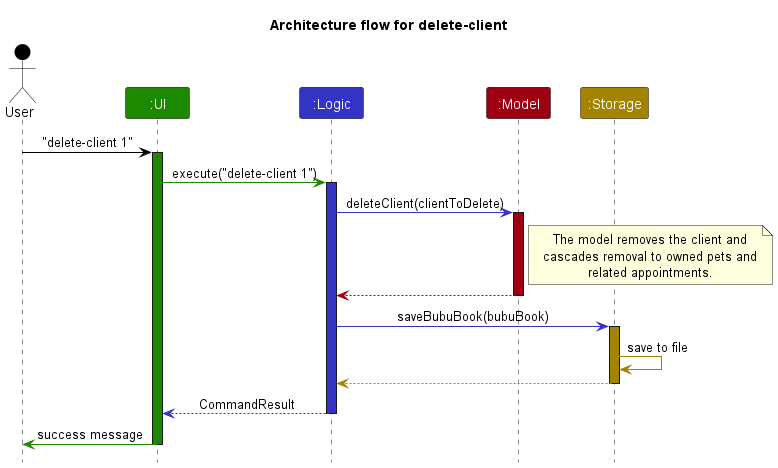
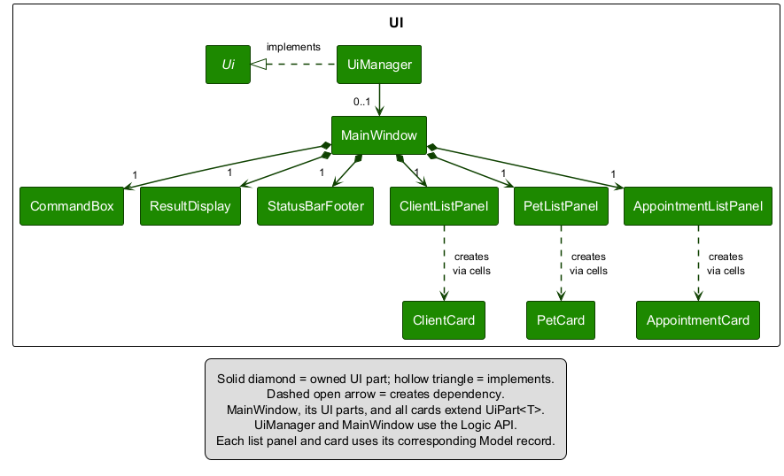
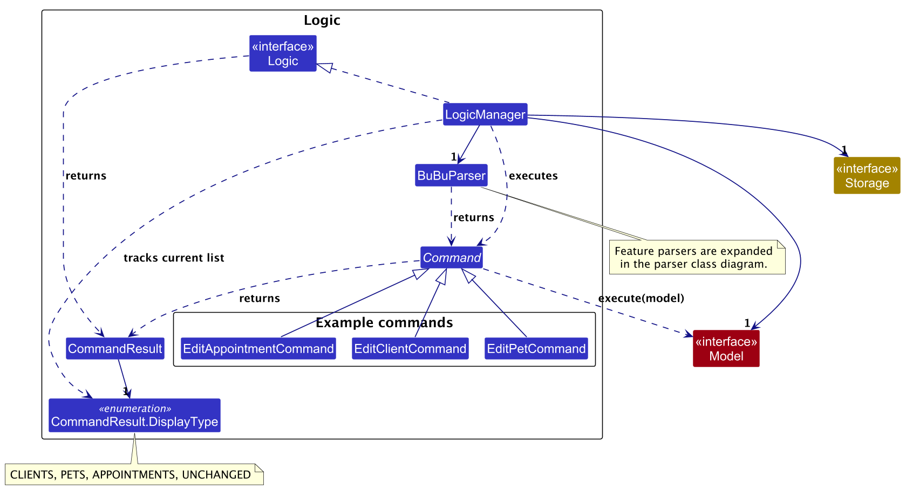
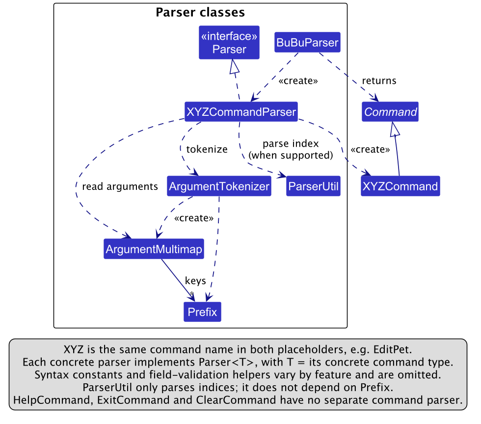
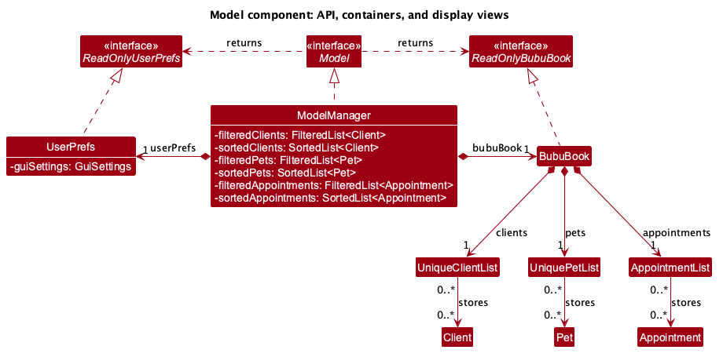
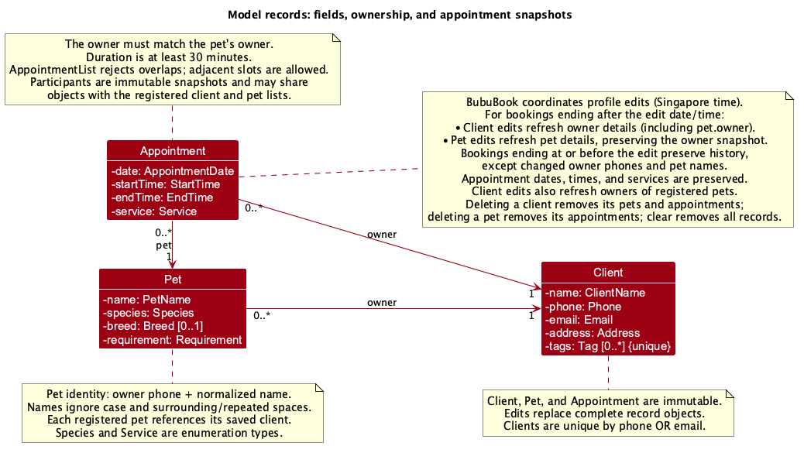
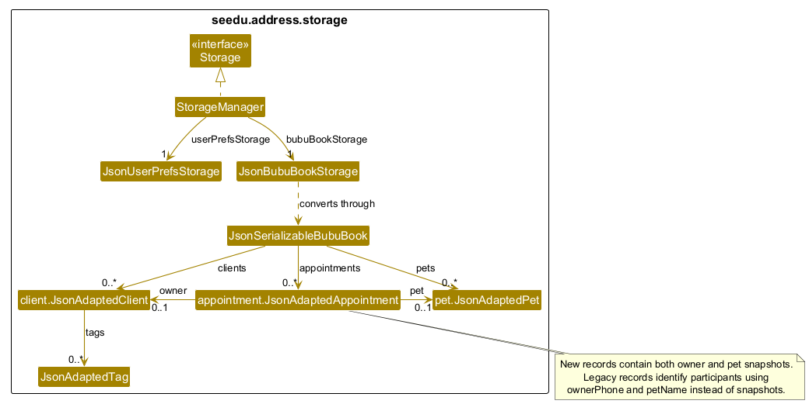
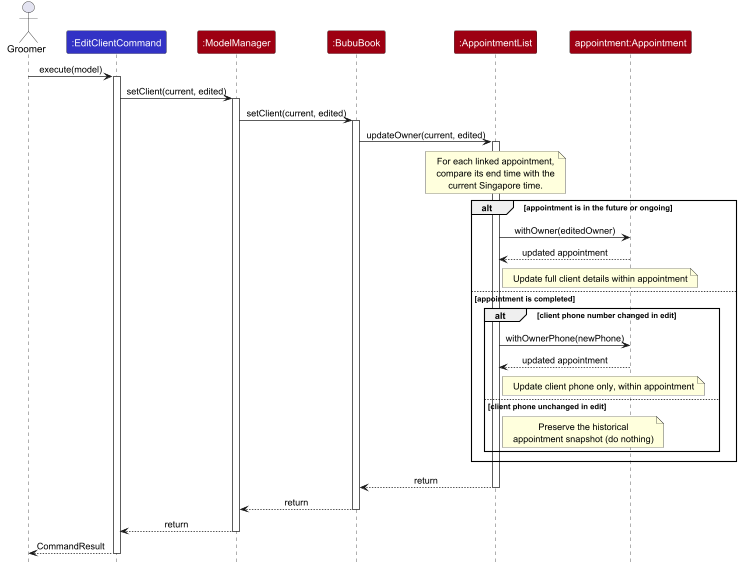
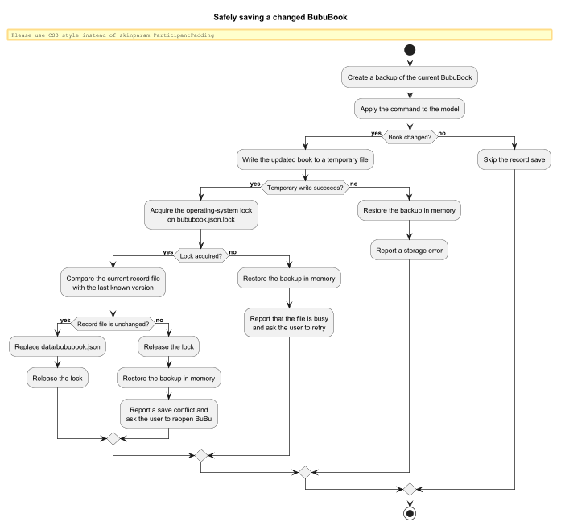

* Table of Contents
{:toc}

--------------------------------------------------------------------------------------------------------------------

## **Acknowledgements**

* _{List the sources of reused or adapted ideas, code, documentation, and third-party libraries here, with links to the originals.}_

--------------------------------------------------------------------------------------------------------------------

## **Setting up, getting started**

Refer to the guide [_Setting up and getting started_](SettingUp.md).

--------------------------------------------------------------------------------------------------------------------

## **Design**

:bulb: **Tip:** The `.puml` files used to create diagrams are in `docs/diagrams`. Refer to the [_PlantUML Tutorial_ at se-edu/guides](https://se-education.org/guides/tutorials/plantUml.html) to learn how to create and edit diagrams.

### Current code organization

The source tree is organized by component and feature. Related commands, parsers, model records,
storage adapters, and UI panels are grouped into their respective packages.

| Responsibility | Package under `seedu.address` |
| --- | --- |
| Shared model and preferences | `model` |
| Client, pet, and appointment records | `model.client`, `model.pet`, `model.appointment` |
| Feature commands | `logic.commands.client`, `logic.commands.pet`, `logic.commands.appointment` |
| Feature parsers and CLI prefixes | `logic.parser.client`, `logic.parser.pet`, `logic.parser.appointment` |
| Shared tokenization and command routing | `logic.parser` (`BuBuParser`) |
| JSON record adapters | `storage.client`, `storage.pet`, `storage.appointment` |
| Client, pet, and appointment cards and list panels | `ui.client`, `ui.pet`, `ui.appointment` |

Tests mirror these feature packages. Shared parsing utilities stay in `logic.parser.ParserUtil`;
client and pet field parsing lives in `ClientParserUtil` and `PetParserUtil` respectively.

### Architecture

The ***Architecture Diagram*** given above explains the high-level design of the App.

Between components, an arrow points from a component to another component that it depends on.

The following provides a quick overview of the main components and their interactions.

**Main components of the architecture**

**`Main`** (consisting of classes [`Main`](https://github.com/AY2627S1-CS2103T-W08-2/tp/blob/master/src/main/java/seedu/address/Main.java) and [`MainApp`](https://github.com/AY2627S1-CS2103T-W08-2/tp/blob/master/src/main/java/seedu/address/MainApp.java)) is in charge of the app launch and shut down.

* At app launch, it initializes the other components in the correct sequence, and connects them up with each other.
* At shut down, it shuts down the other components and invokes cleanup methods where necessary.

The bulk of the app's work is done by the following four components:

* [**`UI`**](#ui-component): The UI of the App.
* [**`Logic`**](#logic-component): The command executor.
* [**`Model`**](#model-component): Holds the data of the App in memory.
* [**`Storage`**](#storage-component): Reads data from, and writes data to, the hard disk.

[**`Commons`**](#common-classes) represents a collection of classes used by multiple other components.

**How the architecture components interact with each other**

The *Sequence Diagram* below shows how the components interact with each other for the scenario where the user issues
the command `delete-client 1`.

Each of the four main components (also shown in the diagram above),

* defines its *API* in an `interface` with the same name as the Component.
* provides its functionality through a concrete `{Component Name}Manager` class that implements the corresponding API interface.

For example, the `Logic` component defines its API in `Logic.java` and implements it in `LogicManager.java`. Other components interact with a component through its interface rather than its concrete class, preventing them from coupling to that component's implementation, as illustrated in the following partial class diagram.

The sections below give more details of each component.

### UI component

The **API** of this component is specified in [`Ui.java`](../src/main/java/seedu/address/ui/Ui.java)

`UiManager` implements `Ui` and creates the `MainWindow` when the application starts. Both hold a reference to the `Logic` API. The diagram focuses on UI ownership and card creation. Shared `UiPart<T>` inheritance and dependencies on `Logic` and model records are described below; JavaFX controls, internal list-cell classes, and the command callback are omitted for clarity.

The UI consists of a `MainWindow` and its parts, such as `CommandBox`, `ResultDisplay`, `ClientListPanel`,
`PetListPanel`, `AppointmentListPanel`, and `StatusBarFooter`. All of these, including `MainWindow`, inherit from
the abstract `UiPart<T>` class (as do `ClientCard`, `PetCard`, and `AppointmentCard`), which captures common behavior among classes that represent visible GUI parts.

The `UI` component uses the JavaFX UI framework. The layouts of these UI parts are defined in matching `.fxml` files in `src/main/resources/view`. For example, [`MainWindow.fxml`](../src/main/resources/view/MainWindow.fxml) specifies the layout of [`MainWindow`](../src/main/java/seedu/address/ui/MainWindow.java).

The `UI` component,

* executes user commands using the `Logic` component.
* displays observable lists obtained through `Logic`, so changes to model data update the lists automatically.
* keeps a reference to the `Logic` component, because the `UI` relies on the `Logic` to execute commands.
* depends on `Client`, `Pet`, and `Appointment` classes from the `Model` component because its three list panels
  display those records.

`CommandBox` invokes a `CommandExecutor` callback supplied by `MainWindow`. This callback calls `Logic.execute`, updates `ResultDisplay` with success or error feedback, and handles display changes, help, and exit requests. `MainWindow` also restores and saves window settings through `Logic`; `StatusBarFooter` displays the data file path supplied at startup.

`MainWindow` creates all three list panels once and keeps them bound to the model's observable lists. It shows exactly
one panel at a time, initially clients, using the `DisplayType` carried by `CommandResult`: `CLIENTS`, `PETS`, or `APPOINTMENTS`.

Each list panel uses custom JavaFX cells to create its corresponding card. Pet cards show an owner heading at the start of each owner group, and appointment cards show a date heading at the start of each date group. Their panels refresh these headings when the lists change. Sorting is provided by the model.

Successful list commands set this value, and commands that do not change the selected record type use
`UNCHANGED`. Hidden panels are also unmanaged so that they do not occupy layout space. The record heading and count track the visible list.

`ResultDisplay` presents command output and error messages supplied by `MainWindow`. Successful command
feedback and parsing or execution errors appear in a text area with distinct success and error styles.
It also supports a scrollable, formatted command-reference view. Switching views hides and unmanages the
inactive view, and each new result replaces the previous content in the selected view.

`CommandBox` maintains session-only command history independently of the `Logic` and `Model` components. It records
each non-empty submission before invoking its `CommandExecutor`, so commands that fail parsing or execution can also
be recalled and corrected. Edited or unfinished text is saved separately in `commandDraft` before navigating history, rather than appended to the submitted-command history. The `commandHistory` list keeps submissions in order, while `historyIndex` points to the currently recalled entry. An index equal to the list size represents the position after the newest submission.

The command text field handles <kbd>↑</kbd> and <kbd>↓</kbd> key presses through a JavaFX event filter. <kbd>↑</kbd>
moves the index towards the oldest entry and <kbd>↓</kbd> moves it towards the blank position. Navigation stops at
both boundaries rather than wrapping. When no commands have been recorded, the event filter does not consume either
arrow key, allowing normal focus or page navigation to proceed. When an entry is loaded, the caret is placed at the
end so that users can edit it immediately. This state is intentionally not persisted: restarting the application
starts a new history and avoids storing commands that may contain client information.

### Logic component

**API** : [`Logic.java`](https://github.com/AY2627S1-CS2103T-W08-2/tp/blob/master/src/main/java/seedu/address/logic/Logic.java)

Here's a (partial) class diagram of the `Logic` component:

`LogicManager` implements `Logic` and holds one `BuBuParser`, `Model`, and `Storage` reference.
The diagram follows AB3's representative-command convention: `XYZCommand` and `XYZCommandParser` stand for a matching
command/parser pair, such as `AddClientCommand` / `AddClientCommandParser`, `EditPetCommand` / `EditPetCommandParser`,
or `ListAppointmentsCommand` / `ListAppointmentsCommandParser`. They are placeholders, not classes in the codebase.
Add, edit, delete, and list commands share this structure; their validation and model interactions differ.
The boxes group components and parser classes for explanation; feature subpackages are omitted.
The `Model` and `Storage` boxes expose only the interfaces used by `LogicManager`.

`Command.execute(Model)` returns a `CommandResult`, whose `DisplayType` identifies the list to show or requests that
the current selection remain unchanged. List commands change the view without saving records; successful record-changing
commands are saved by `LogicManager` when the book has changed. The overview omits the direct construction of
`HelpCommand`, `ExitCommand`, and `ClearCommand`, which have no separate command parsers.

The sequence diagram below illustrates the interactions within the `Logic` component, taking `execute("delete-client 1")` API call as an example.

The appointment command flows are shown separately because both commands support two target forms:

How the `Logic` component works:

1. `LogicManager` passes the input to `BuBuParser.parseCommand`. For feature commands, `BuBuParser` creates the
   matching parser (e.g., `DeleteClientCommandParser`) and calls `parse(arguments)`. It creates `ClearCommand`,
   `HelpCommand`, and `ExitCommand` directly.
2. Before executing the returned `Command`, `LogicManager` rejects commands other than `HelpCommand` if the saved
   book was unreadable at startup and checks any display requirement declared by `Command.getRequiredDisplayType()`.
3. `LogicManager` takes a book snapshot, then the command executes against `Model` and returns a `CommandResult`.
   `HelpCommand`, `ExitCommand`, `ListClientsCommand`, `ListPetsCommand` and `ListAppointmentsCommand` skip record
   saving. Other commands save only if the resulting book differs from the snapshot. If saving fails, the snapshot
   is restored and a `CommandException` is thrown instead of returning success.
4. After successful execution and any required save, `LogicManager` updates its current display type from the
   result and returns it to the UI. `UNCHANGED` preserves the previously selected list.

The following partial diagram expands the parser group using the same `XYZ` convention. It shows how a feature parser
creates its matching command and uses the shared tokenization classes. The optional `ParserUtil` dependency applies
to parsers that accept indices. Feature-specific syntax constants, field-validation helpers, and model value objects
are omitted from the diagram and described below.

How the parsing works:
* `BuBuParser` separates the command word from its arguments and selects the corresponding feature parser.
  Each feature parser implements `Parser<T>` for its command type: for example, `EditPetCommandParser`
  implements `Parser<EditPetCommand>`. Its `parse` method validates the arguments and constructs the command,
  which `BuBuParser` returns as a `Command`.
* Prefix constants belong to `ClientCliSyntax`, `PetCliSyntax`, or `AppointmentCliSyntax` in the corresponding
  feature package. `ArgumentTokenizer` uses the supplied `Prefix` objects to produce an `ArgumentMultimap`,
  which stores argument values by prefix.
* `ParserUtil` parses positive indices; it does not define or depend on prefixes. `ClientParserUtil` parses
  client fields, including owner phone numbers used by pet and appointment commands. `PetParserUtil` parses
  pet names. For example, `EditAppointmentCommandParser` uses all three utilities because it supports an index,
  an owner phone number, and a pet name.

Commands that use displayed indexes declare their required DisplayType; LogicManager rejects them when the corresponding
list is not currently displayed. The detailed index and identifier selection behavior is described in
[Stable Record Selection and Displayed Indexes](#stable-record-selection-and-displayed-indexes).

### Model component

**API** : [`Model.java`](https://github.com/AY2627S1-CS2103T-W08-2/tp/blob/master/src/main/java/seedu/address/model/Model.java)

The `Model` component,

* defines its API in `Model`. `ModelManager` implements that API and owns separate `BubuBook` and `UserPrefs`
  containers initialized from the supplied data; immutable record objects can be shared with the source book.
  Callers access the book through `ReadOnlyBubuBook` and preferences through `ReadOnlyUserPrefs`.
  `BubuBook` is the aggregate that stores clients, pets, and appointments in `UniqueClientList`, `UniquePetList`, and
  `AppointmentList` respectively.
* represents clients as immutable `Client` records with a name, phone, email, address, and tags. A client is considered
  a duplicate when another client has the same phone number or email address. Email identity ignores case throughout
  the address. Full `Client.equals` equality compares every field, including the exact email spelling,
  so a spelling-only email edit is still detected as a record change. `ReadOnlyBubuBook` also exposes
  `hasAppointmentOwnerConflict`; client add/edit commands use it to reject a newly introduced phone number already
  used by a different appointment owner snapshot (see
  [Historical appointment snapshots and linked-record consistency](#historical-appointment-snapshots-and-linked-record-consistency)).
* represents pets as immutable `Pet` records with a name, owner, species, optional breed, and grooming requirements.
  Each pet refers to its owning `Client`; when the book adds or replaces a pet, it resolves that owner to the matching
  client stored in the book. Pet identity is the owner's phone number and normalized pet name, so names are unique per
  owner and letter case or leading, trailing, and repeated whitespace do not affect matching. Normalization is used
  for identity comparisons; `PetName` retains the supplied spelling, and full pet equality compares all profile fields.
* represents appointments as immutable records containing owner and pet snapshots, date, start and end times, and
  service. The date and start time identify a booking slot; full appointment equality includes all fields.
  The `Appointment` constructor requires its owner to equal its pet's owner and a duration of at least 30 minutes.
  `AppointmentList` rejects overlapping time slots regardless of owner or pet, while permitting adjacent appointments.
  The add/edit appointment commands resolve participants from the registered clients and pets and require the resulting
  start to be strictly in the future in Singapore time. These checks are separate from model construction, allowing
  historical appointments and their original participant snapshots to be loaded and retained.
* uses immutable value objects for field validation, with `Species` and `Service` represented as enums. For example,
  `AppointmentDate` validates a real calendar date, `StartTime` permits 08:00–19:30, and `EndTime` permits 08:30–20:00,
  with both time types restricted to 30-minute intervals. Cross-field duration validation belongs to `Appointment`,
  and schedule-wide overlap validation belongs to `AppointmentList`.
* coordinates linked-record updates through `BubuBook`. The detailed appointment snapshot policy is described in
  [Historical appointment snapshots and linked-record consistency](#historical-appointment-snapshots-and-linked-record-consistency).
* stages and validates the complete replacement book in `resetData` before changing its live lists. The bulk setters
  have narrower responsibilities: `setClients` checks client uniqueness and resolves registered pet owners before
  updating the client and pet lists; `setPets` resolves owners to saved clients and checks pet uniqueness before
  replacing pets; `setAppointments` checks the complete replacement schedule for nulls and overlaps before applying it.
  These bulk operations do not invoke the individual edit operations' appointment cascades; appointment replacement
  retains the supplied participant snapshots. The observable list instances remain connected to the model so existing
  UI views continue to receive changes (see [Loading data](#loading-data) for reconstruction from storage).
* maintains observable display views for clients, pets, and appointments by filtering and sorting the book's lists.
  Pets are ordered by owner name (case-insensitive), owner phone, and normalized pet name; appointments are ordered by
  date and start time. Clients initially retain stored order and can be sorted by name, ignoring case, on request;
  that sort remains active for subsequent list changes. Changing a filter updates the existing display view rather
  than replacing its backing list. Display ordering does not reorder the saved lists in `BubuBook`.
* stores GUI preferences in `UserPrefs`, which is exposed through the read-only preferences interface.
* has no dependency on the `Logic`, `UI`, or `Storage` components. Those components use the model API to interact with
  the domain data.

:information_source: **Note:** These are complementary class diagrams. The overview above shows the model API, owned containers, and display views. Collection membership uses ordinary associations because immutable records can be shared with snapshots. The diagram below expands the record fields and participant relationships; an appointment's owner and pet are snapshots and may differ from the currently registered profiles. Association roles identify participant references, which are not repeated as attributes. Reading-direction markers are shown for the `stores` association labels. 

### Storage component

**API** : [`Storage.java`](https://github.com/AY2627S1-CS2103T-W08-2/tp/blob/master/src/main/java/seedu/address/storage/Storage.java)

The `Storage` component:

* saves the complete BubuBook in `data/bububook.json`, with user preferences in `preferences.json`.
* is implemented by `StorageManager`, which delegates to `JsonBubuBookStorage` and `JsonUserPrefsStorage`.
* represents the complete saved data with `JsonSerializableBubuBook`, which contains lists of
  `JsonAdaptedClient`, `JsonAdaptedPet`, and `JsonAdaptedAppointment` records. Each client record can contain
  multiple `JsonAdaptedTag` records.
* represents pets with `JsonAdaptedPet`, which stores each owner's name and phone. It uses these identifiers to
  resolve the registered client when the data is loaded. The `breed` property contains a string when known and
  JSON `null` when no breed is set; older records with no `breed` property are also accepted when loading.
* represents appointments with `JsonAdaptedAppointment`, which stores client and pet snapshots so appointments
  can be reconstructed independently of the current registered records. Legacy appointment records identify their
  participants using `ownerPhone` and `petName` instead of snapshots.

Therefore, an appointment contains participant snapshots, while a pet refers to its owner using identifiers. This
is why the appointment adapter is associated with the participant adapters in the class diagram, while the pet
adapter is not associated with the client adapter.

#### Loading data
{:.no_toc}

Storage reconstructs the saved data in the following order:

1. Clients and their tags are loaded.
2. Pets are loaded and their owners are resolved against the loaded clients.
3. Appointments and their participant snapshots are loaded.

Loading fails if required fields or lists are missing, records are invalid, clients or pets are duplicated, or
appointments overlap. If the data file is missing, BuBu starts with sample data. Startup behavior for an unreadable file
is described in [Reliable Persistence and Recovery](#reliable-persistence-and-recovery).

#### Saving and rollback
{:.no_toc}

The save and rollback mechanism, including temporary-file replacement, file locking, stale-write detection, and
restoration of the in-memory book after failure, is described in [Reliable Persistence and Recovery](#reliable-persistence-and-recovery).

#### Pet-profile persistence
{:.no_toc}

Pet edits update the model through `EditPetCommand` → `ModelManager.setPet()` → `BubuBook.setPet()` →
`UniquePetList.setPet()`. After the command returns, `LogicManager` saves the changed book through
`StorageManager` to `data/bububook.json`, as it does for other record-changing commands.

`Pet` is immutable, so an edit replaces one complete profile rather than mutating individual fields. The optional
breed is serialized as a nullable property: adding a pet without `b/BREED` writes `"breed": null`, and clearing an
existing breed with `b/` writes the same value on the next successful save. The property is retained, not omitted.
Loading accepts either an absent `breed` property or `"breed": null` as an unknown breed. This representation also
applies to pet snapshots stored within appointments; completed snapshots retain their historical breed under the
participant-update rules below.

#### Appointment persistence
{:.no_toc}

Appointments belong to the shared `BubuBook` and are saved in the same file as clients and pets.
`JsonAdaptedAppointment` stores nested owner and pet snapshots alongside the date, times, and service.
Loading reuses equal registered objects when available and can reconstruct historical snapshots independently of the
registered lists. This storage capability does not provide a supported JSON import or data-merging workflow.

BuBu supports records maintained through its commands and unchanged backups of its own saved files. Importing external
JSON, merging books, and manually modifying records are unsupported. In particular, assigning the same phone to different
people in manually constructed client and appointment records violates the ownership invariant. Such records may pass
structural validation; BuBu treats a shared phone as one owner and does not infer separate identities from snapshot
emails or names. The loader rejects detected invalid fields, duplicate registered clients or pets, mismatched snapshot
participants, and overlapping appointments, but is not a general-purpose validator for externally constructed books.

Older appointments containing only `ownerPhone` and `petName` are resolved against registered clients and pets
and saved as snapshots on the next write. If a legacy participant is missing, loading fails because the old
format contains insufficient information to reconstruct its profile; no placeholder profiles are created.

### Common classes

Classes used by multiple components are in the `seedu.address.commons` package.

--------------------------------------------------------------------------------------------------------------------

## **Implementation**

This section describes selected implementation mechanisms that involve non-trivial design decisions or coordination
across multiple components.

### Stable record selection and displayed indexes

BuBu supports both displayed-index and identifier-based record selection. These two forms serve different purposes.

A displayed index is meaningful only relative to the currently displayed and filtered list. Before executing an
index-based command, `LogicManager` checks the command's required `DisplayType`. The command is rejected if the
corresponding client, pet, or appointment list is not currently displayed. If the check succeeds, the index is resolved
against the filtered list in the order shown to the user.

Identifier-based commands search the complete `BubuBook` instead of the currently displayed list. Clients can be
identified by their current phone number, pets by their normalized name together with their owner's phone number, and
appointments by their date and start time. These commands therefore continue to work even when the target record is
hidden by a display filter.

This distinction prevents a temporary display position from being treated as a permanent domain identity. It also allows
short index-based commands for fast interaction while retaining stable identifier-based commands for operations that
should not depend on the current display state.

**Design consideration:**

* Index-based commands are concise, but they depend on the selected panel, active filter, and sort order.
Identifier-based commands are more stable and can search the complete book, but require more input. BuBu supports both
forms and applies each only where its behavior is appropriate.

### Historical appointment snapshots and linked-record consistency

BuBu stores each appointment as an immutable record containing snapshots of the client and pet involved in that appointment.
The registered client and pet profiles contain current information, while the appointment snapshots preserve the information
recorded for a particular booking.

This separation prevents edits to current profiles from rewriting the historical details of completed appointments.
At the same time, ongoing and future appointments should reflect the latest client and pet information.

BubuBook coordinates changes across the related collections. When a client is edited, it replaces the client in
UniqueClientList, updates the owners of linked pets, and delegates appointment updates to AppointmentList.updateOwner.
When a pet is edited, it replaces the pet and delegates linked appointment updates to AppointmentList.updatePet.

The update rules are:

| Appointment status at the edit time | After Client edit                                                                | After Pet edit                                                      |
|-------------------------------------|----------------------------------------------------------------------------------|---------------------------------------------------------------------|
| Ongoing or future                   | Refresh the complete client snapshot                                             | Refresh the complete pet snapshot                                   |
| Completed                           | Preserve the recorded client details, but propagate a changed owner phone number | Preserve the recorded pet details, but propagate a changed pet name |

An appointment is considered completed when its end date and time is at or before the edit time in Singapore time.
An appointment currently in progress is treated as ongoing.

Appointment ownership is matched by phone number; pet linkage additionally uses the normalized pet name. Client edits
also refresh registered pets' owners and the owner reference within each updated appointment's pet snapshot.
Pet edits refresh the name, species, breed, and requirements of linked ongoing and future appointments while
preserving the recorded owner.
Both update paths preserve appointment dates, times, and services. Removing a client removes its pets and appointments;
removing a pet removes its appointments, including completed bookings. Clearing the book removes all three record types.

These update rules are centralized in `BubuBook` and `AppointmentList`, ensuring that all client and pet edits apply the same snapshot policy.

**Design considerations:**

* Storing only references to current client and pet profiles would simplify updates, but completed appointments would
change whenever a profile was edited.
* Preserving snapshots in completed appointments preserves the original phone number, but after a client changes their
phone number, the completed appointment would no longer match the current client or pet. Operations such as lookup,
editing, or deletion could miss the appointment and leave linked records inconsistent.

Therefore, BuBu propagates phone-number changes even for completed appointments, while preserving other historical details.

### Reliable persistence and recovery

BuBu saves changed records through Storage. Window preferences are stored separately in `preferences.json`.

Saving follows this sequence.

1. `LogicManager` keeps a backup copy of the current `BubuBook`.
2. The command updates the live model. Read-only commands and commands that leave records unchanged skip saving.
3. Storage acquires the operating-system lock on `data/bububook.json.lock`.
4. While holding the lock, Storage compares the record file's contents with the last successfully read or saved contents.
5. If they match, Storage writes the updated book to a temporary file beside the record file.
6. Storage replaces `data/bububook.json` with the temporary file and records the newly saved contents.
   It requests an atomic replacement, with a regular replacement as a fallback if the filesystem does not support atomic moves.
7. Storage releases the lock when the save attempt finishes.

For example, if two instances read the same records and the first saves a change, the second rejects its save
when it detects that the file contents have changed.

If writing fails, BuBu restores the previous in-memory records and reports an error. If the file was changed or deleted
by another process, BuBu rejects the save with a RecordSaveConflictException and asks the user to reopen the application.

If BuBu cannot read the record file at startup, it creates an empty in-memory book and rejects commands other than
`help`. The window controls remain available to close the app.
This prevents the empty book from overwriting the unreadable file.

**Design consideration:**

* Writing directly to the record file would be simpler, but a failed write could leave it incomplete. Using a temporary
  file, a write lock, and a file-version check adds complexity but reduces the risk of data loss.

## **Documentation, logging, testing, dev-ops**

* [Documentation guide](Documentation.md)
* [Testing guide](Testing.md)
* [Logging guide](Logging.md)
* [DevOps guide](DevOps.md)

--------------------------------------------------------------------------------------------------------------------

## **Appendix: Requirements**

### Product scope

**Target user profile**:

* freelance mobile pet groomer
* manages a significant number of contacts, appointments and pet care requirements
* prefers desktop apps over other types of applications
* can type fast
* prefers typing to mouse interactions
* is reasonably comfortable using CLI apps

**Value proposition**: Manage contacts, track grooming preferences and care requirements,
and schedule upcoming appointments faster than with a typical mouse-driven GUI application.

### User stories

Priorities: High (must have) - `* * *`, Medium (nice to have) - `* *`, Low (unlikely to have) - `*`

The following stories are supported by the current commands described in the User Guide.

| Priority | As a …​                                | I want to …​                                                    | So that I can…​                                                                |
| -------- |----------------------------------------|-----------------------------------------------------------------|--------------------------------------------------------------------------------|
| `* * *`  | new user                               | see usage instructions                                          | refer to instructions when I forget how to use the App                         |
| `* * *`  | mobile pet groomer                     | add a new client and their pet’s basic information              | start building my digital roster                                               |
| `* * *`  | mobile pet groomer                     | list all pets or one client's pets                              | review their care requirements before a visit                                  |
| `* * *`  | user                                   | add a new client                                                | save their contact details for future visits                                   |
| `* * *`  | mobile pet groomer                     | edit a client's contact details                                 | keep phone numbers and service addresses up to date                            |
| `* * *`  | mobile pet groomer                     | update a pet's profile and care requirements                     | prepare for the pet's current grooming needs                                   |
| `* * *`  | user                                   | find a client by name                                           | locate details of clients without having to go through the entire list         |
| `* * *`  | mobile pet groomer                     | book a single grooming appointment on a specific date           | get a new job on my calendar                                                   |
| `* * *`  | mobile pet groomer                     | easily find the address for my next appointment                 | know exactly where to drive                                                    |
| `* * *`  | user                                   | delete a client                                                 | remove entries that I no longer need                                           |
| `* * *`  | user                                   | delete a pet using its name and owner's phone number            | remove pet records that I no longer need                                       |
| `* * *`  | mobile pet groomer                     | cancel a grooming appointment                                   | remove a booking that will no longer take place                                |
| `* * *`  | mobile pet groomer                     | list upcoming appointments or appointments on a chosen date      | plan visits and review previous bookings                                       |
| `* *`    | mobile pet groomer                     | make changes to my upcoming appointments easily                  | accommodate changes to a client's availability or requested service            |
| `* *`    | user                                   | recall previously submitted commands                             | repeat or correct commands without retyping them                              |
| `* *`    | user                                   | clear all clients, pets, and appointments                         | start again with an empty set of records                                      |
| `*`      | mobile pet groomer                     | add custom labels to clients (e.g., VIP, prefers-weekends)        | see useful client context alongside their contact details                      |
| `*`      | user with many clients in the BubuBook | sort clients by name                                            | locate a client easily                                                         |

The following stories are future requirements, not features of the current release. Client tags can currently
be saved and displayed, but searching by tag is not supported. Pet care notes can record behavioral quirks as
free text; dedicated behavior tags are not supported. Completed appointments are determined by their end time,
not by a manual completion action.

| Priority | As a … | I want to … | So that I can … |
| --- | --- | --- | --- |
| `* *` | mobile pet groomer | find available timeslots automatically | fit new jobs into my schedule easily |
| `* *` | mobile pet groomer | mark an appointment as completed | distinguish finished jobs from pending visits explicitly |
| `* *` | user | hide private contact details | minimize the chance of someone seeing them by accident |
| `*` | mobile pet groomer | tag behavioral quirks (e.g., cage-anxious, nipper, hyperactive) | prepare safety gear and allocate handling time appropriately |
| `*` | mobile pet groomer | filter clients by custom labels | manage my customer base by specific business criteria |

### Use cases

**System:** BuBu

**Use case:** UC1 - Add a client and their pet

**Actor:** Groomer

**Preconditions:** -

**Guarantees:**
- A client or pet is saved only if all of its details are valid.
- The pet is linked to the client it was added under.
- No two clients share the same phone number or email.

**MSS:**

1. Groomer requests to add a client, providing the client's name, phone number, email and address.
2. BuBu adds the client.
3. Groomer requests to add a pet under the client, providing the pet's name, species, optional breed and grooming requirements.
4. BuBu adds the pet under the client.
5. Groomer requests to view the client's pets.
6. BuBu shows the client's pets and their details.

Use case ends.

**Extensions:**

- 1a. BuBu detects a missing, repeated or invalid client detail.
    - 1a1. BuBu informs Groomer of the problem.
    - 1a2. Groomer enters the corrected details.
    - Steps 1a1-1a2 are repeated until the details are valid.
    - Use case resumes from step 2.
- 1b. The phone number or email already belongs to another client.
    - 1b1. BuBu informs Groomer that the client already exists.
    - 1b2. Groomer enters a different phone number or email.
    - Steps 1b1-1b2 are repeated until the phone number and email are unique.
    - Use case resumes from step 2.
- 3a. A pet detail is missing, repeated or invalid (e.g. an unsupported species or an invalid field length).
    - 3b1. BuBu informs Groomer of the problem.
    - 3b2. Groomer enters the corrected details.
    - Steps 3b1-3b2 are repeated until the details are valid.
    - Use case resumes from step 4.
- 3b. The client already has a pet with the same name.
    - 3c1. BuBu informs Groomer of the duplicate.
    - Use case ends.

---

**System:** BuBu

**Use case:** UC2 - Book a grooming appointment

**Actor:** Groomer

**Preconditions:** The client and their pet are already saved.

**Guarantees:**

- The new appointment does not overlap any existing appointment.
- The appointment lies within working hours (08:00-20:00) and starts in the future.

**MSS:**

1. Groomer searches for the client.
2. BuBu shows the matching clients and their details.
3. Groomer requests to view the client's pets.
4. BuBu shows the pets and their care requirements.
5. Groomer requests to view the appointments on the intended date.
6. BuBu shows the appointments on that date.
7. Groomer requests to schedule an appointment for the pet, specifying the date, start time, end time and service.
8. BuBu adds the appointment and shows the updated appointment list.

Use case ends.

**Extensions:**

- 2a. No client matches the search.
    - 2a1. BuBu informs Groomer that no clients match.
    - 2a2. Groomer enters a different search keyword.
    - Steps 2a1-2a2 are repeated until a client is found.
    - Use case resumes from step 3.
- 5a. The date is not a valid date.
    - 5a1. BuBu informs Groomer of the problem.
    - 5a2. Groomer enters a corrected date.
    - Steps 5a1-5a2 are repeated until the date is valid.
    - Use case resumes from step 6.
- 6a. There are no appointments on that date.
    - 6a1. BuBu informs Groomer that nothing is scheduled.
    - Use case resumes from step 7.
- 7a. A scheduling detail is missing, repeated or invalid (e.g. past date, outside working hours, not on 30-minute intervals, end less than 30 minutes after start, unsupported service).
    - 7a1. BuBu informs Groomer of the problem.
    - 7a2. Groomer enters corrected details.
    - Steps 7a1-7a2 are repeated until the details are valid.
    - Use case resumes from step 8.
- 7b. The time slot overlaps an existing appointment.
    - 7b1. BuBu identifies one conflicting saved appointment by pet name, date, and time range, even if it is hidden by the current list filter.
    - 7b2. Groomer enters a different time slot.
    - Steps 7b1-7b2 are repeated until the slot is free.
    - Use case resumes from step 8.

---

**System:** BuBu

**Use case:** UC3 - Edit an appointment

**Actor:** Groomer

**Preconditions:** At least one appointment is saved in BuBu.

**Guarantees:**

- The appointment is updated only when the complete replacement is valid.
- The resulting appointment starts in the future and does not overlap any other appointment.
- If saving fails, the previous appointment remains unchanged.

The appointment can be identified by its current date and start time, or by its index in the displayed appointment list.
Any field that is not supplied remains unchanged.

**MSS:**

1. Groomer enters `edit-appointment` with an appointment target and one or more replacement fields.
2. BuBu resolves the target appointment and validates the replacement owner, pet, date, time, service, duration, and
   schedule availability.
3. BuBu replaces the appointment, saves the updated BubuBook, and shows the updated appointment details.

Use case ends.

**Extensions:**

- 1a. The target is missing, incomplete, duplicated, or invalid, or no replacement field is supplied.
    - 1a1. BuBu reports the validation error and leaves the schedule unchanged.
      Use case ends.
- 1b. An index target is used while the appointment list is not displayed, or the index is outside the displayed list.
    - 1b1. BuBu reports the invalid displayed target and leaves the schedule unchanged.
      Use case ends.
- 1c. No appointment matches the supplied date and start time.
    - 1c1. BuBu reports that no matching appointment was found and leaves the schedule unchanged.
      Use case ends.
- 2a. The replacement owner or pet is not registered, the resulting start is not in the future, the duration is too
  short, or the slot overlaps another appointment.
    - 2a1. BuBu reports the validation error and leaves the schedule unchanged.
      Use case ends.
- 3a. The updated BubuBook cannot be saved.
    - 3a1. BuBu restores the pre-edit records and reports the storage error.
      Use case ends.

---

**System:** BuBu

**Use case: Delete an appointment**

**Actor:** Groomer

**Preconditions:** At least one appointment is saved in BuBu.

**Guarantees:**

- Only the appointment selected by the supplied target is deleted.
- The linked client, linked pet, and all other appointments remain unchanged.
- If saving fails, the deleted appointment is restored in memory.

**MSS:**

1. Groomer enters `delete-appointment` with an appointment index or an exact date and start-time pair.
2. BuBu resolves the selected appointment from the displayed list or complete saved list.
3. BuBu deletes the appointment, saves the updated BubuBook, and shows the deleted appointment details.

Use case ends.

**Extensions:**

- 1a. The target is missing, incomplete, duplicated, invalid, or combines an index with date/time identifiers.
    - 1a1. BuBu reports the validation error and leaves the schedule unchanged.
      Use case ends.
- 1b. An index target is used while the appointment list is not displayed, or the index is outside the displayed list.
    - 1b1. BuBu reports the invalid displayed target and leaves the schedule unchanged.
      Use case ends.
- 2a. No appointment starts at the supplied date and start time.
    - 2a1. BuBu reports that no matching appointment was found and leaves the schedule unchanged.
      Use case ends.
- 3a. The updated BubuBook cannot be saved.
    - 3a1. BuBu restores the pre-deletion records and reports the storage error.
      Use case ends.

---

**System:** BuBu

**Use case:** UC4 - Remove a client who has pets and appointments

**Actor:** Groomer

**Preconditions:** The target client is saved in BuBu. The client may have saved pets and appointments.

**Guarantees:**

- The target client, all pets owned by that client, and all of the client's appointments are deleted together.
- Completed and future appointments linked to the client are deleted.
- Unrelated clients, pets, and appointments remain unchanged.
- If saving fails, the previous records are restored in memory.

**MSS:**

1. Groomer enters `delete-client` with a displayed client index or a client's phone number.
2. BuBu resolves the target client from the displayed client list or complete saved client list.
3. BuBu deletes the client and all linked pets and appointments, saves the updated BubuBook, and shows the deleted
   client details.

Use case ends.

**Extensions:**

- 1a. The target is missing, invalid, duplicated, or combines an index with a phone identifier.
    - 1a1. BuBu reports the validation error and leaves all records unchanged.
      Use case ends.
- 1b. An index target is used while the client list is not displayed, or the index is outside the displayed list.
    - 1b1. BuBu reports the invalid displayed target and leaves all records unchanged.
      Use case ends.
- 2a. No saved client has the supplied phone number.
    - 2a1. BuBu reports that no client matches the phone number and leaves all records unchanged.
      Use case ends.
- 3a. The updated BubuBook cannot be saved.
    - 3a1. BuBu restores the pre-deletion records and reports the storage error.
      Use case ends.

---

**System:** BuBu

**Use case:** UC5 - Prepare for a day's appointments

**Actor:** Groomer

**Preconditions:** At least one client with at least one pet profile is saved in BuBu.

**MSS:**

1. Groomer requests to view the appointments on a given date.
2. BuBu shows the appointments in start-time order.
3. Groomer searches for the client of an appointment.
4. BuBu shows the client's phone number, email and address.
5. Groomer requests to view the client's pets.
6. BuBu shows the pets and their care requirements.

Steps 3-6 are repeated for each appointment on the date.

Use case ends.

**Extensions:**

- 1a. The date is not a valid date.
    - 1a1. BuBu informs Groomer of the problem.
    - 1a2. Groomer enters a corrected date.
    - Steps 1a1-1a2 are repeated until the date is valid.
    - Use case resumes from step 2.
- 2a. There are no appointments on that date.
    - 2a1. BuBu informs Groomer that nothing is scheduled.
    - Use case ends.
- 3a. No client matches the search.
    - 3b1. BuBu informs Groomer that no clients match.
    - 3b2. Groomer enters a different search keyword.
    - Steps 3b1-3b2 are repeated until the intended client is found.
    - Use case resumes from step 4.

**Use case: Edit a pet**

**MSS**

1. Groomer enters `edit-pet` with either a displayed pet index or the pet's current name and owner's phone number,
   together with one or more updated fields.
2. BuBu validates the selectors and requested field values.
3. BuBu selects the pet from the displayed pet list for an index, or searches the saved BubuBook by normalized current
   name and exact owner phone number.
4. BuBu creates a replacement pet profile, preserving the owner and any fields that were not supplied.
5. BuBu verifies that the replacement name does not duplicate another pet belonging to the same owner.
6. BuBu replaces the saved pet profile, updates linked appointment snapshots according to their completion status,
   and saves any changed records. The owner, active pet filter, and selected panel are preserved.

Use case ends.

**Extensions**

* 2a. A required selector is missing, targeting forms are mixed, an index or field value is invalid, a prefix is
  repeated or unsupported outside requirements, or no updated field is supplied.

    * 2a1. BuBu reports the validation error and leaves the profile unchanged.

      Use case ends.

* 3a. The pet panel is not displayed for an index-based edit, the index exceeds the displayed list, or no pet matches
  the supplied current name and owner phone number.

    * 3a1. BuBu reports the display, index, or lookup error and leaves all records unchanged.

      Use case ends.

* 5a. The requested new name duplicates another pet under the same owner.

    * 5a1. BuBu reports the duplicate-name error and leaves the profile unchanged.

      Use case ends.

* 6a. The updated BubuBook cannot be saved.

    * 6a1. BuBu restores the pre-edit records and reports the storage error.

      Use case ends.

**Use case: Delete a pet**

**MSS**

1.  User requests to delete a pet by providing the pet's name and its owner's phone number.
2.  BubuBook finds the pet matching both values.
3.  BubuBook deletes the pet.

    Use case ends.

**Extensions**

* 1a. The command format, pet name, or owner phone number is invalid.

    * 1a1. BubuBook shows an error message.

      Use case ends.

* 2a. No pet matches the given name and owner phone number.

    * 2a1. BubuBook shows an error message.

      Use case ends.

*{More to be added}*

### Non-Functional Requirements

The requirements below are acceptance targets. The performance and display targets require measurements on the
release build before they can be reported as met.

1. BuBu should launch and support its documented commands on Windows, macOS and Ubuntu with Java 25 and a compatible
   JavaFX runtime. Record the OS version, processor architecture and Java distribution used for release testing.
2. BuBu should save and reload 1,000 valid records, comprising 100 clients, 300 pets and 600 non-overlapping
   appointments, without losing records or their relationships.
3. After launch, users should be able to enter, submit and recall documented commands using the keyboard, without
   requiring a mouse for those actions.
4. For the dataset in requirement 2, each list command, client search, and single-record add, edit or delete should
   display feedback and refresh the active list within one second. Measure from pressing Enter until both are updated,
   after one warm-up run, across ten valid runs per operation. Use local storage on an SSD and a machine with at least
   four CPU cores and 8 GB RAM, and record its exact configuration.
5. On the same machine and dataset, the operating system's reported resident memory for the Java process should remain
   below 500 MB during ten minutes of listing, searching and single-record updates. Record the monitoring tool and
   sample once per second, including the JavaFX process memory.
6. Changed records should be saved before a command reports success, and should remain available after restarting
   the application from the same folder. If saving fails, the application should restore the previous in-memory records
   and report the failure. Persistence after a successful save must be verified by restarting the application.
7. With Java installed, BuBu should run from a single executable JAR in a user-writable folder without an application
   installer or administrative privileges.
8. BuBu should store records and preferences locally in human-readable JSON files without an external database.
   Supported data maintenance consists of app commands and restoring unchanged BuBu backups.
9. After installation, record management and bundled command help should work offline.
10. Each instance should serve one user and rely on the operating system's account and file permissions for access
    control.
11. Invalid commands should leave records unchanged. Concurrent instances should reject stale or competing saves
    and preserve the other instance's saved records.
12. A missing record file should allow startup with sample records in memory. An empty, malformed or unreadable file
    should allow the window to open while protecting the file from record commands. Commands other than `help`
    should report the startup-data problem when submitted.
13. At 100% OS display scaling and a maximised window on 1366×768, 1440×900 and 1920×1080 screens, the command input,
    feedback and all three record views should be readable. Check records with maximum accepted field lengths,
    using wrapping and vertical scrolling to access long content. Verify this on each tested OS from requirement 1.

For performance and display testing, record the release version, test dataset, environment and results.

### Glossary

* **JSON (JavaScript Object Notation)**: The lightweight, human-readable plain-text format used by BuBu for local persistent file storage.
* **CLI (Command Line Interface)**: A text-based user interface where the groomer issues discrete text commands to execute operations.
* **GUI (Graphical User Interface)**: The visual layout built with JavaFX that displays formatted client lists, pet profiles and schedule information.
* **Appointment**: A scheduled mobile grooming engagement linking a specific client and pet to a date, time, and care requirements.
* **Care Requirements**: Special notes, medical conditions, temperamental traits, behavioral warnings, or styling preferences associated with a pet.
* **Behavioral Quirks**: Temperamental traits or handling considerations, such as anxiety around dryers, recorded as text in a pet's care requirements.
* **Client**: A pet owner profile containing contact information, including name, phone number, email and home address.
* **Groomer**: The primary user and actor of BuBu; an independent mobile pet groomer managing appointments, client contacts, and pet profiles on-the-go.
* **Pet Profile**: A distinct record belonging to a specific client that tracks the pet's name, species, optional breed, and care requirements.
* **Participant Snapshot**: Client or pet details saved with an appointment. Completed appointments retain historical details subject to the linked phone-number and pet-name update rules.
* **Rollback**: Restoring the previous in-memory records after a save fails.
* **Service**: A grooming option assigned to an appointment. Supported values are `Bath and brush`, `Full groom`, `Nail trim`, and `Other`.
* **Time Slot**: A continuous duration on a given date during which a grooming appointment takes place, constrained to 30-minute intervals within working hours.
* **Working Hours**: The allowable operating time frame within which appointments can be booked, defined in BuBu as 08:00 to 20:00.

--------------------------------------------------------------------------------------------------------------------

## **Appendix: Instructions for manual testing**

Given below are instructions to test the app manually.

:information_source: **Note:** These instructions only provide a starting point for testers to work on;
testers are expected to do more *exploratory* testing.

### Launch and shutdown

1. Initial launch

   1. Download the JAR file and copy it into an empty folder.

   2. Double-click the JAR file. 
      Expected: The GUI opens with a set of sample contacts. The window size may not be optimal.

2. Saving window preferences

   1. Resize the window to an optimal size. Move the window to a different location. Close the window.

   2. Relaunch the app by double-clicking the JAR file. 
       Expected: The most recent window size and location are retained.

3. _{ more test cases …​ }_

### Command history

Use a fresh application session and keep the command box focused. Arrow keys recall text without executing it;
only <kbd>Enter</kbd> submits a command.

1. Submit `list-clients`, then `list-pets`. Press <kbd>↑</kbd> twice. 
   Expected: The box first shows `list-pets`, then `list-clients`. Another <kbd>↑</kbd> stays at `list-clients`.
   The pet panel remains displayed because recalling text does not execute it.
2. Press <kbd>↓</kbd> twice. 
   Expected: The box shows `list-pets`, then becomes blank. Another <kbd>↓</kbd> leaves it blank.
3. Type `add-pet p/Mochi` without submitting. Press <kbd>↑</kbd>, then <kbd>↓</kbd>, then <kbd>↓</kbd> again. 
   Expected: The box shows `list-pets`, restores the unfinished `add-pet p/Mochi`, then becomes blank.
   No pet is added, and the unfinished input is not a submitted history entry.
4. Submit `not-a-command`, clear its retained text, then press <kbd>↑</kbd>. 
   Expected: The failed command can be recalled as `not-a-command`; navigating history does not execute it again.
5. Close and relaunch the application. Focus the blank command box and press <kbd>↑</kbd>. 
   Expected: No command from the previous session is recalled.

### Viewing help

1. Prerequisites: Run `list-clients q/Alex` in a fresh test folder with the sample clients. Note the visible
   client and count. Type `help` and press <kbd>Enter</kbd>. 
   Expected: A scrollable command reference headed `AVAILABLE COMMANDS` appears in the expanded feedback area.
   Command names and formats are formatted, and the filtered client panel and saved records stay unchanged.
2. Scroll down in the reference, then choose **Help → Help**. 
   Expected: The same reference is shown from the top inside the main window.
3. Focus the command box and press <kbd>F1</kbd> (use <kbd>Fn</kbd> + <kbd>F1</kbd> if required by the keyboard). 
   Expected: The reference appears even while the command box is focused. The selected list and filter are unchanged.
4. Submit `list-clients`, then reopen help and submit `not-a-command`. 
   Expected: Each non-help submission replaces the reference with its normal success or error feedback and restores
   the usual feedback-area height. `list-clients` restores the full client list; the invalid command changes no records.
5. Repeat the three help entry points without an internet connection. 
   Expected: The bundled reference remains available. For unreadable startup data, repeat the help entry points in
   [Invalid startup data and recovery](#saving-data); help works while other commands remain blocked.

### Clearing all records

Use a separate test folder. Complete the successful setup and first booking in [Adding an appointment](#adding-an-appointment)
below, so the book contains clients, Mochi, and a saved appointment. Run these steps in order.

1. Run `list-appointments d/02-01-9999` to hide the booking on `01-01-9999`, then submit `clear`. 
   Expected: `Clients, pets, and appointments have been cleared!` The appointment panel remains selected and empty.
   All clients, pets, and appointments are removed, including the booking hidden by the date filter. No confirmation
   is requested.
2. Run `list-clients`, `list-pets`, and `list-appointments d/01-01-9999` separately. 
   Expected: Each list is empty; clearing has removed all three record types, not just the displayed records.
3. Close and relaunch BuBu and repeat the three list commands. 
   Expected: The saved book remains empty; sample clients are not restored. Submit `clear` again. 
   Expected: The same success message appears and all lists remain empty.

### Switching the displayed record list

1. Displaying each record type

   1. Test case: `list-clients` 
      Expected: The client list is visible and the clients are shown in the result area/list panel.

   2. Test case: `list-pets` 
      Expected: The pet list replaces the client list in the GUI.

   3. Test case: `list-appointments` 
      Expected: The appointment list replaces the pet list and shows ongoing/future appointments in date and start-time order.

2. Rejecting an index for the wrong record type

   1. Prerequisites: The pet list is currently displayed and contains at least one pet.

   2. Test case: `delete-client 1` 
      Expected: No client is deleted. The status message is `The current displayed list does not match the record type selected by the index.`

   3. Test case: `delete-pet 1` 
      Expected: The first displayed pet is deleted.

   4. Prerequisites: The appointment list is currently displayed and contains at least one appointment.

   5. Test case: `delete-appointment 1` 
      Expected: The first displayed appointment is deleted.

### Adding a client

1. Adding clients with and without tags

   1. Prerequisites: No saved client uses phone numbers `91234567` or `82345678`, or email addresses
      `zoe@example.com` or `amelia@example.com`. Run the following cases in order.

   2. Test case: `add-client n/Zoe Tan i/91234567 e/zoe@example.com a/10 Clementi Road` 
      Expected: `Client added: Zoe Tan (91234567).` Running `list-clients` shows Zoe with the supplied details and no tags.

   3. Test case: `add-client n/Amelia Lim i/82345678 e/amelia@example.com a/20 Tampines Road t/friends t/regular` 
      Expected: `Client added: Amelia Lim (82345678).` Running `list-clients` shows Amelia with both tags.

2. Rejecting duplicate phone numbers or email addresses

   1. Prerequisites: Zoe Tan from the successful addition above exists. No client uses `93456789` or `other@example.com`.

   2. Test case: `add-client n/Other Client i/91234567 e/other@example.com a/30 Bedok Road` 
      Expected: No client is added. The status message is `The phone number already belongs to another client.`

   3. Test case: `add-client n/Other Client i/93456789 e/zoe@example.com a/30 Bedok Road` 
      Expected: No client is added. The status message is `The email already belongs to another client.`

3. Rejecting missing or repeated required fields

   1. Test case: `add-client n/Test Client i/93456789 a/30 Bedok Road` 
      Expected: No client is added. The status message is `Email (e/) is required. Example: e/alice@example.com.`

   2. Test case: `add-client n/Test Client i/93456789 e/ a/30 Bedok Road` 
      Expected: No client is added. The status message is `Email (e/) cannot be blank.`

   3. Test case: `add-client n/Test Client n/Another Client i/93456789 e/test@example.com a/30 Bedok Road` 
      Expected: No client is added. The status message is `Name (n/) was supplied more than once. Keep only one n/ field.`

   4. Other cases to try: Omit or leave blank each of `n/`, `i/`, and `a/` in an otherwise complete command;
      repeat each of `i/`, `e/`, and `a/`. 
      Expected: No client is added. The status message identifies the missing field or reports a repeated field.

4. Rejecting invalid client details

   1. Prerequisites: Use `add-client n/Test Client i/93456789 e/test@example.com a/30 Bedok Road` as the base command.
      Replace only the specified field for each case below.

   2. Test case: Replace `n/Test Client` with `n/A` or `n/Test123`. 
      Expected: No client is added. The status message is `Client names must be nonblank and contain 2-60 Unicode code points after NFC normalization. Use Unicode letters, combining marks, spaces, apostrophes, hyphens or full stops.`

   3. Test case: Replace `i/93456789` with `i/73456789`, `i/9345678`, or `i/9345678a`. 
      Expected: No client is added. The status message is `The phone must be an 8-digit Singapore mobile number beginning with 8 or 9.`

   4. Test case: Replace `e/test@example.com` with `e/testexample.com` or `e/test@example`. 
      Expected: No client is added. The status message is `Email must be at most 254 characters, contain one @, no spaces, and a domain with a full stop.`

   5. Test case: Replace `a/30 Bedok Road` with `a/1234` or `a/30 Bedok Road!`. 
      Expected: No client is added. The status message is `Addresses must be nonblank and contain 5-120 characters. Use English letters (A-Z, a-z), digits (0-9), spaces, commas, full stops, apostrophes ('), hyphens (-) or #.`

5. Saving added clients

   1. Prerequisites: Zoe Tan and Amelia Lim were successfully added above.

   2. Test case: Close and relaunch BuBu, then run `list-clients`. 
      Expected: Both clients remain saved with their contact details and tags.

### Listing clients

1. Listing all clients alphabetically

   1. Prerequisites: Zoe Tan and Amelia Lim from the adding-client tests exist. Run `list-pets` first.

   2. Test case: `list-clients` 
      Expected: The client list replaces the pet list. The status message is `Listed all clients.` All saved clients
      are displayed in alphabetical order by name, ignoring case, with Amelia Lim before Zoe Tan.

2. Searching across client contact details

   1. Prerequisites: Zoe Tan from the adding-client tests exists. For the exact counts below, ensure no other client's
      name, phone, email, or address contains `zoe`, `91234567`, `zoe@example.com`, or `10 Clementi Road`.

   2. Test case: `list-clients q/zOe` 
      Expected: Only Zoe Tan is displayed. The status message is `Found 1 client(s).` Matching ignores letter case.

   3. Test case: Run `list-clients q/91234567`, `list-clients q/zoe@example.com`, and
      `list-clients q/10 Clementi Road` separately. 
      Expected: Each command displays Zoe Tan and reports `Found 1 client(s).`, matching the phone, email, and address respectively.

   4. Test case: `list-clients q/  zOe  ` 
      Expected: Surrounding spaces are ignored. Zoe Tan is displayed and the status message is `Found 1 client(s).`.

   5. Test case: `list-clients q/Road` 
      Expected: All clients with `Road` anywhere in their name, phone, email, or address are displayed alphabetically.
      The status message reports the number of matches. This includes Amelia Lim and Zoe Tan from the adding-client tests.

   6. Prerequisites: No client's name, phone, email, or address contains the literal substring `zoe!`.
      Test case: `list-clients q/zoe!` 
      Expected: The query is accepted because punctuation is supported. The client panel shows an empty list and
      the status message is `No clients match "zoe!".` All saved client records remain unchanged.

3. Handling no matches and restoring the full list

   1. Prerequisites: No client's contact details contain `zzzznomatch`.

   2. Test case: `list-clients q/zzzznomatch` 
      Expected: The client list is empty. The status message is `No clients match "zzzznomatch".`.

   3. Test case: `list-clients` 
      Expected: All saved clients are displayed again, alphabetically. The status message is `Listed all clients.`.
      Searching has not deleted any clients.

   4. Test case: Run `list-clients` when no clients are saved, using a separate test data set. 
      Expected: The client list is empty and the status message is `Listed all clients.`.

4. Rejecting invalid search input

   1. Test case: `list-clients q/` or `list-clients q/   ` 
      Expected: No client records change. The command is rejected with
      `Search keyword must be 1-60 characters, not blank, and contain no control characters.`

   2. Test case: Enter `list-clients q/` followed by 60 consecutive `a` characters, then repeat with 61. 
      Expected: The 60-character keyword is accepted and reports matching clients or no matches. The 61-character
      keyword is rejected with the invalid-keyword message above.

   3. Test case: `list-clients q/zoe q/amelia` 
      Expected: The command is rejected with `Each search field may be specified only once.`

   4. Test case: `list-clients zoe` or `list-clients n/Zoe` 
      Expected: The command is rejected with an invalid-command-format message and the command usage.

### Editing a client

1. Identifying a client by current phone number or displayed index

   1. Prerequisites: A saved client uses phone `91234567`. Note their contact details and tags.

   2. Test case: Run `list-pets`, then `edit-client i/91234567 n/Zoe Tan`. 
      Expected: The client's name changes to Zoe Tan, with all other details unchanged. The status message
      begins with `Edited client:` and the client panel is displayed with its existing filter preserved.

   3. Test case: Run `list-clients q/zzzznomatch` to hide the client, then `edit-client i/91234567 t/`. 
      Expected: The same client's tags are cleared despite being hidden. The client panel remains filtered with no matches.

   4. Test case: Run `list-appointments`, then `edit-client i/91234567 n/Zoe Lim`. 
      Expected: The edit succeeds and the client list replaces the appointment panel.

   5. Prerequisites: At least one client is saved. Run `list-clients` to clear any search filter and display the
      client panel. Note the details of the client at displayed index 1.
      Test case: `edit-client 1 n/Zoe Tan` 
      Expected: The first displayed client's name becomes Zoe Tan, with their phone, email, address and tags
      unchanged. Other clients remain unchanged. The status message begins with `Edited client:` and contains
      the updated client details. The client panel remains displayed; the index refers to the displayed order.

2. Rejecting invalid edits

   1. Test case: `edit-client 0 n/Zoe Tan`, `edit-client n/Zoe Tan`, or `edit-client i/ n/Zoe Tan` 
      Expected: No client changes. The respective messages are `Index must be a positive integer.`,
      `Missing client selector. Use INDEX or i/CURRENT_PHONE.`, and
      `Current phone selector (i/) is blank. Use i/CURRENT_PHONE.`

   2. Test case: `edit-client i/91234567`, `edit-client i/91234567 p/123`, or
      `edit-client i/91234567 n/Zoe n/Amy` 
      Expected: No client changes. The respective messages are `No update supplied. Provide at least one of n/, p/, e/, a/ or t/.`,
      `New phone number (p/) must be eight digits beginning with 8 or 9.`, and
      `Multiple values specified for the following single-valued field(s): n/`.

   3. Test case: `edit-client i/89998888 n/Zoe Tan` when that phone number is not saved 
      Expected: No client changes. The message is `No saved client has this phone number.`.

   4. Test case: `edit-client i/91234567 i/82345678 n/Zoe Tan` 
      Expected: No client changes. The status message is
      `Multiple values specified for the following single-valued field(s): i/`.

   5. Prerequisites: Another saved client has phone `82345678` and email `other@example.com`.

   6. Test case: `edit-client i/91234567 p/82345678` or `edit-client i/91234567 e/other@example.com` 
      Expected: The phone edit is rejected with `The phone number already belongs to another client.` and the email edit
      is rejected with `The email already belongs to another client.`, even when the other client is hidden by a search.

3. Updating linked records and saving changes

   1. Prerequisites: The client with phone `91234567` owns a pet and has an appointment. Phone `89998888` is unused.

   2. Test case: `edit-client i/91234567 p/89998888`, then `list-pets i/89998888` 
      Expected: The client's phone changes and the same pet appears under the new phone.
      The linked appointment's owner phone also becomes `89998888`. Ongoing and future bookings receive the current
      owner details; completed bookings retain their other recorded owner details. Appointment dates, times and
      services remain unchanged.

   3. Test case: `edit-client i/91234567 n/Zoe Tan`, then `edit-client i/89998888 n/Zoe Tan` 
      Expected: The old identifier is rejected as unknown. The new identifier succeeds.

   4. Test case: Close and relaunch BuBu, then inspect the client, pet, and appointment. 
      Expected: The updated phone and links persist after restart.

### Deleting a client

1. Deleting by displayed index

   1. Prerequisites: Add multiple clients, then run `list-clients` so the client panel displays them.

   2. Test case: `delete-client 1` 
      Expected: The first displayed client and all of that client's linked pets and appointments are deleted. The
      status message begins with `Deleted client:` and the selected panel remains unchanged.

   3. Test case: Run `list-pets`, then enter `delete-client 1`. 
      Expected: No client is deleted. BuBu reports that the current displayed list does not match the record type
      selected by the index.

   4. Test case: `delete-client 0` 
      Expected: No client is deleted. BuBu reports `Client index must be a positive whole number.`

   5. Test case: `delete-client 999` when fewer than 999 clients are displayed. 
      Expected: No client is deleted. The status message is `The person index provided is invalid.`

2. Deleting by phone number

   1. Prerequisites: A client with phone number `91234567` exists. No client uses the valid phone number `89999999`.

   2. Test case: `delete-client i/91234567` 
      Expected: The matching client is deleted. The status message reports the number of linked pets and appointments removed.

   3. Test case: `delete-client i/89999999` 
      Expected: No client is deleted. The status message is `No client with the given phone number exists.`.

   4. Test case: `delete-client i/12` 
      Expected: No client is deleted. The status message is `The phone must be an 8-digit Singapore mobile number beginning with 8 or 9.`

3. Cascade deletion feedback

   1. Prerequisites: A client owns two pets and has two appointments, while another client has at least one independent record.

   2. Test case: Delete the first client by index or with `delete-client i/PHONE_NUMBER`. 
      Expected: The selected client, both pets and both appointments are removed. The success message reports `2 pets` and
      `2 appointments`; the other client's records remain.

4. Invalid identifiers and parameters

   1. Test case: `delete-client` 
      Expected: The command is rejected with `Choose a client index or provide i/PHONE_NUMBER.`.

   2. Test case: `delete-client 1 i/91234567` 
      Expected: The command is rejected with `Choose either a client index or a phone identifier, not both.`.

   3. Test case: `delete-client x/91234567` 
      Expected: The command is rejected with an unknown-parameter message naming `x/`.

   4. Test case: `delete-client i/91234567 i/92345678` 
      Expected: The command is rejected with a duplicate-prefix message for `i/`.

   5. _{ more test cases …​ }_

### Adding a pet

Use a separate test folder containing the release JAR. A first launch without a record file supplies Alex Yeoh
(`87438807`) and Bernice Yu (`99272758`). Keep the original data folder for normal use.
Run groups 1–3 in order. Groups 4–5 each require a fresh test folder.

1. Adding pets with and without a breed

   1. Prerequisites: A client named `Alex Yeoh` with phone number `87438807` exists and has no pets named `Mochi` or `BuBu`.

   2. Test case: `add-pet p/Mochi i/87438807 s/Dog b/Golden retriever r/Nervous around dryers` 
      Expected: `Pet added: Mochi (Dog, Golden retriever) under Alex Yeoh.`

   3. Test case: `add-pet p/BuBu i/87438807 s/Cat r/Calm with baths` 
      Expected: `Pet added: BuBu (Cat) under Alex Yeoh.` Both pets remain saved under Alex Yeoh.

2. Rejecting a duplicate pet name

   1. Prerequisites: Alex Yeoh already has a pet named `Mochi`.

   2. Test case: `add-pet p/Mochi i/87438807 s/Dog r/Calm with baths` 
      Expected: The pet is not added; the status message is `This client already has a pet named Mochi.`

   3. Test case: `add-pet p/  mOcHi   i/87438807 s/Dog r/Calm with baths` 
      Expected: The same duplicate message is displayed. Run `list-pets i/87438807` to confirm that only
      `BuBu` and `Mochi` remain under Alex.

3. Invalid pet details and owner identifiers

   1. Prerequisites: Alex Yeoh (phone number `87438807`) exists.

   2. Test case: `add-pet p/Mochi i/87438807 s/Dog` 
      Expected: No pet is added. Feedback starts with `Missing required field: REQUIREMENTS.` and then shows the `add-pet` usage and example.

   3. Test case: `add-pet p/Mochi i/87438807 s/Horse r/Calm with baths` 
      Expected: No pet is added. The status message is `Species must be Dog, Cat, Rabbit, Guinea Pig, or Other.`

   4. Test case: `add-pet p/Mochi i/99999999 s/Dog r/Calm with baths` when no client has that phone number 
      Expected: No pet is added. The status message is `No saved client has this phone number. Add the client before adding a pet.`

   5. Test case: `add-pet p/Mochi p/BuBu i/87438807 s/Dog r/Calm with baths` 
      Expected: No pet is added. The status message is `Each pet field may be specified only once.`

   6. Test case: `add-pet p/Luna i/87438807 s/Cat b/ r/Calm with baths` 
      Expected: No pet is added. Feedback is `Breed must be 2-50 characters and use valid text characters.`

   7. Test case: `add-pet i/1111` 
      Expected: Feedback is `The phone must be an 8-digit Singapore mobile number beginning with 8 or 9.`
      The supplied invalid phone is reported before missing required fields.

4. Preserving the selected view and owner filter

   1. Prerequisites: In a fresh test folder, Alex and Bernice exist and have no pets.
      Run `list-pets i/99272758`.

   2. Test case: `add-pet p/Mochi i/87438807 s/Dog r/Calm with baths` 
      Expected: `Pet added: Mochi (Dog) under Alex Yeoh.` The pet panel stays empty because Bernice's filter is active.
      Run `list-pets i/87438807` to see Mochi.

   3. Test case: Run `list-clients q/99272758`, then
      `add-pet p/BuBu i/87438807 s/Cat r/Use shampoo/conditioner`. 
      Expected: `Pet added: BuBu (Cat) under Alex Yeoh.` Bernice remains the only displayed client.
      Run `list-pets i/87438807` to confirm that BuBu's requirements contain `Use shampoo/conditioner`.

5. Saving profiles across restart

   1. Prerequisites: In a fresh test folder, complete the two successful additions in group 1.

   2. Test case: Run `exit`, relaunch from the same folder, then run `list-pets i/87438807`. 
      Expected: `Found 2 pet(s) under Alex Yeoh.` BuBu appears before Mochi. Mochi shows
      `Golden retriever`, BuBu shows `Not recorded`, and both retain their original care requirements.

### Listing pets

Use the records from adding-pet group 1 or group 5, with exactly two pets under Alex and none under Bernice.
Run the following groups in order. All rejected list commands should preserve the previous view and records.

1. Listing all saved pets

   1. Prerequisites: `Mochi` and `BuBu` exist under Alex Yeoh (phone number `87438807`).

   2. Test case: `list-pets` 
      Expected: Feedback is `Listed all pets.` The list panel shows Alex Yeoh's pets in the order `BuBu`, `Mochi`.

2. Listing one client's pets

   1. Prerequisites: Alex Yeoh (phone number `87438807`) has exactly two pets, `Mochi` and `BuBu`,
      and Bernice Yu (phone number `99272758`) has no pets.

   2. Test case: `list-pets i/87438807` 
      Expected: Feedback is `Found 2 pet(s) under Alex Yeoh.` The list panel shows `BuBu` and `Mochi` with their species, optional breed, and requirements.

   3. Test case: `list-pets i/99272758` 
      Expected: `Bernice Yu has no saved pet profiles.`

   4. Test case: `list-pets i/99999999` when no client has that phone number 
      Expected: `No saved client has this phone number.`

3. Invalid owner identifiers and command formats

   1. Test case: `list-pets i/71234567` 
      Expected: The status message is `The phone must be an 8-digit Singapore mobile number beginning with 8 or 9.`

   2. Test case: `list-pets i/87438807 i/99272758` 
      Expected: `The owner phone may be specified only once.`

   3. Test case: `list-pets x/extra` 
      Expected: Feedback starts with `Invalid command format!` and then shows the `list-pets` usage and example.

4. Switching views while preserving the client search

   1. Test case: Run `list-clients q/87438807`, then `list-pets i/87438807`. 
      Expected: The pet panel opens with BuBu and Mochi and feedback `Found 2 pet(s) under Alex Yeoh.`

   2. Test case: `edit-client 1 a/24 Lily Road` 
      Expected: `The current displayed list does not match the record type selected by the index.`

   3. Test case: `edit-client i/87438807 a/24 Lily Road` 
      Expected: The client panel opens with Alex as its only result, demonstrating that the previous client search
      was preserved. Alex's address is now `24 Lily Road`.

### Editing a pet

Run these scenarios using an isolated test data set. Each top-level scenario has its own prerequisites; restore those
records before moving to the next scenario, particularly after renaming a pet. Run separate commands within a test
case one at a time. For rejected edits, verify that the pet, its owner, other pets, and linked appointments are unchanged.

1. Editing multiple fields without relying on a displayed index

   1. Prerequisites: A pet named `Mochi` belongs to Alex Yeoh (phone number `87438807`), and the pet has a known breed.

   2. Test case: Run `list-clients`, then enter
      `edit-pet p/Mochi i/87438807 n/Mochi Bean s/Cat r/Prefers quiet drying`. 
      Expected: The command succeeds even though the client list is displayed. The status message is
      `Edited pet: Mochi Bean`. Running `list-pets i/87438807` shows `Mochi Bean`, species `Cat`, the original breed,
      and the updated requirement. The client panel remains displayed until `list-pets` is run. The pet remains owned
      by Alex Yeoh, whose client profile is unchanged. A later identifier-based edit must use `p/Mochi Bean`;
      `edit-pet p/Mochi i/87438807 r/Needs calm handling` now reports
      `No pet with the specified name and owner phone number was found.`

2. Updating or clearing an optional breed

   1. Prerequisites: A pet named `Mochi` belongs to Alex Yeoh and has a saved breed.

   2. Test case: `edit-pet p/Mochi i/87438807 b/British Shorthair` 
      Expected: The pet's breed changes to `British Shorthair`; all omitted fields are unchanged.

   3. Test case: `edit-pet p/Mochi i/87438807 b/` 
      Expected: The pet's breed is removed. The status message is `Edited pet: Mochi`. `list-pets i/87438807` no
      longer displays a breed for that pet. After closing BuBu, inspect the pet in `data/bububook.json`: its `breed`
      property is present with value `null`, as it is for a pet added without a breed. Relaunching keeps the breed unset.

3. Accepting punctuation and slash shorthand in requirements

   1. Prerequisites: Alex Yeoh (`87438807`) owns a pet named `Mochi`.

   2. Test case: `edit-pet p/Mochi i/87438807 r/Bad/care` 
      Expected: The edit succeeds with `Edited pet: Mochi`. `list-pets i/87438807` shows the exact requirement
      `Bad/care`; it is valid because `/` is allowed and the text is within the 5–240 character limit. The name,
      owner, species, and breed are unchanged.

   3. Test case: `edit-pet p/Mochi i/87438807 r/Wash w/o scented conditioner s/Cat` 
      Expected: The edit succeeds with `Edited pet: Mochi`. The requirement becomes `Wash w/o scented conditioner`
      and the species becomes `Cat`. The supported `s/` prefix starts a separate field; `w/o` remains requirement text.

4. Matching pets by both name and owner, independently of the active filter

   1. Prerequisites: Alex Yeoh (`87438807`) and Bernice Yu (`99272758`) each have a pet named `Milo`.

   2. Test case: `edit-pet p/mIlO i/87438807 r/Needs calm handling` 
      Expected: Only Alex Yeoh's Milo is updated. Bernice Yu's Milo is unchanged.

   3. Test case: Run `list-pets i/99272758`, then
      `edit-pet p/  mIlO  i/87438807 r/Prefers a quiet dryer`. 
      Expected: Alex Yeoh's Milo is updated even though hidden by the active owner filter. Bernice Yu's pet remains
      displayed and unchanged. Run `list-pets i/87438807` to verify the saved requirement.

   4. Test case: `edit-pet p/Milo i/91234567 r/Needs calm handling` when no pet has that owner phone number 
      Expected: No pet is changed. The status message is
      `No pet with the specified name and owner phone number was found.`

5. Editing by displayed index and preserving the owner filter

   1. Prerequisites: Alex Yeoh (`87438807`) owns `BuBu` and `Mochi`, and Bernice Yu (`99272758`) owns another pet.
      Run `list-pets i/87438807`; `BuBu` is displayed before `Mochi`. Note their profiles and Alex Yeoh's client details.

   2. Test case: `edit-pet 1 r/Needs calm handling` 
      Expected: Only Alex Yeoh's `BuBu` receives the new requirement. Feedback is `Edited pet: BuBu`. The pet panel
      stays filtered to Alex Yeoh's two pets; `Mochi`, Bernice Yu's pet, and both client profiles remain unchanged.

   3. Test case: `edit-pet 2 n/Aster` 
      Expected: `Mochi` becomes `Aster` with all other fields unchanged. Feedback is `Edited pet: Aster`. The owner
      filter remains active and the list reorders to `Aster`, then `BuBu`; use the new indices for later commands.

6. Rejecting invalid indices, wrong panels, and mixed selectors

   1. Prerequisites: Run `list-pets i/87438807` with exactly two pets displayed, and ensure Bernice Yu (`99272758`)
      exists with no pets in this scenario.

   2. Test case: `edit-pet 0 r/Needs calm handling` 
      Expected: The command is rejected with `Index must be a positive integer.`

   3. Test case: `edit-pet 3 r/Needs calm handling` 
      Expected: The command is rejected with `The pet index provided is invalid.`, even if another owner's pets exist
      outside the filter.

   4. Test case: Run `list-pets i/99272758`, then `edit-pet 1 r/Needs calm handling`. 
      Expected: The empty displayed list has no valid index; the message is `The pet index provided is invalid.`

   5. Test case: Run `list-clients`, then `edit-pet 1 r/Needs calm handling`. Repeat after `list-appointments`. 
      Expected: Each edit is rejected with
      `The current displayed list does not match the record type selected by the index.` The selected panel is unchanged.

   6. Test case: `edit-pet 1 p/Mochi r/Needs calm handling` or `edit-pet 1 i/87438807 r/Needs calm handling` 
      Expected: The command is rejected with
      `A pet index cannot be combined with pet-name or owner-phone identifiers.`

7. Rejecting a duplicate name under one owner

   1. Prerequisites: Alex Yeoh owns pets named `Mochi` and `BuBu`.

   2. Test case: `edit-pet p/Mochi i/87438807 n/  bUbU  ` 
      Expected: No pet is changed. The status message is `This client already has a pet named BuBu.` The comparison
      ignores letter case and surrounding whitespace.

   3. Test case: Run `list-pets i/87438807`, note `Mochi`'s displayed index, and use
      `edit-pet INDEX n/bUbU`, replacing `INDEX` with that value. 
      Expected: The index form rejects the same duplicate with `This client already has a pet named BuBu.`

8. Rejecting incomplete or malformed edits

   1. Prerequisites: A pet named `Mochi` belongs to Alex Yeoh.

   2. Test case: `edit-pet p/Mochi i/87438807` or `edit-pet 1` 
      Expected: No pet is changed. The status message is `At least one field to edit must be provided.`

   3. Test case: `edit-pet i/87438807 n/Mochi Bean` or `edit-pet p/Mochi n/Mochi Bean` 
      Expected: No pet is changed. The respective messages are `Missing required field: PET_NAME.` and
      `Missing required field: OWNER_IDENTIFIER.`

   4. Test case: `edit-pet p/Mochi i/87438807 s/Horse` or `edit-pet p/Mochi i/71234567 n/Mochi Bean` 
      Expected: No pet is changed. The respective messages are `Species must be Dog, Cat, Rabbit, Guinea Pig, or Other.`
      and `The phone must be an 8-digit Singapore mobile number beginning with 8 or 9.`

   5. Test case: `edit-pet p/Mochi i/87438807 r/Bad`, `edit-pet p/Mochi i/87438807 r/`, or the same command with
      241 consecutive `a` characters after `r/`. 
      Expected: Each edit is rejected with `Requirements must be 5-240 characters.` The values are respectively too
      short, blank, and too long. In contrast, `r/Quiet` (five characters) and 240 consecutive `a` characters are accepted.

   6. Test case: `edit-pet p/Mochi i/87438807 n/Mochi Bean n/Mochi Junior` 
      Expected: No pet is changed. The message is `Each pet field may be specified only once.`

   7. Test case: `edit-pet p/Mochi i/87438807 x/value n/Mochi Bean` 
      Expected: No pet is changed. The message is `Invalid command format. Check the command syntax and try again.`
      Here `x/` is outside the requirements value; this does not prohibit slash text inside `r/`.

   8. Test case: `edit-pet p/Mochi i/87438807 b/X` 
      Expected: No pet is changed. The message is `Breed must be 2-50 characters and use valid text characters.`

9. Updating linked appointment snapshots

   1. Prerequisites: In an isolated test data set, Alex Yeoh (`87438807`) owns `Mochi` with a known breed and has
      one completed and one future appointment for that pet. Use bookings safely before and after the current
      Singapore date/time. Have an unrelated appointment for another pet. Note all profiles, dates, times, services,
      and recorded owner details before editing. Inspect completed bookings using `list-appointments d/DD-MM-YYYY`.
      Appointment cards display pet names and care notes, but not species or breed. To check those fields and the full
      owner snapshot, close BuBu and inspect each appointment's nested `pet` and `owner` in `data/bububook.json`, then
      relaunch before continuing. Do not edit the file during these checks.

   2. Test case: `edit-pet p/Mochi i/87438807 s/Cat b/British Shorthair r/Prefers quiet drying` 
      Expected: The registered pet and its future appointment snapshot contain the new species, breed, and requirements;
      the future appointment card shows the updated care notes.
      The completed appointment retains its original pet details. All appointment owner details, dates, times and
      services, the unrelated appointment, and the saved client profiles remain unchanged.

   3. Test case: `edit-pet p/Mochi i/87438807 n/Mochi Bean` 
      Expected: Both linked appointments use `Mochi Bean`, including the completed booking. Each otherwise retains
      its details from the previous step: the completed booking still has its historical species, breed and requirements.

   4. Test case: `edit-pet p/Mochi Bean i/87438807 b/` 
      Expected: The registered pet and future appointment have no breed; the completed appointment retains its
      historical breed. Repeat these edits with each pet's current displayed index in a fresh copy of this scenario;
      both selector forms apply the same appointment update rules. Ongoing appointments follow the future-booking rule;
      appointments ending at or before the edit time follow the completed-booking rule.

10. Saving the edited profile and linked appointments

    1. Prerequisites: The pet and appointment edits in the preceding scenario succeeded.

    2. Test case: Exit and relaunch BuBu, then run `list-pets i/87438807` and list each appointment's date. 
       Expected: The edited profile, changed name in both bookings, cleared breed in the future booking, and retained
       historical pet details in the completed booking persist after restart.

### Deleting a pet

1. Deleting a pet using its displayed index

   1. Prerequisites: Display the pet list using `list-pets`, with at least one pet shown.

   2. Test case: `delete-pet 1` 
      Expected: The first displayed pet is deleted. The status message is `Deleted pet: PET_NAME`.

   3. Test case: `delete-pet 0` or `delete-pet 999` 
      Expected: No pet is deleted. The status message shows an invalid-index error.

2. Deleting a pet using its name and owner's phone number

   1. Prerequisites: The BubuBook contains a pet named `Milo` whose owner's phone number is `98765432`. No pet owner
      uses the valid phone number `81234567`.

   1. Test case: `delete-pet p/Milo i/98765432` 
      Expected: `Milo` is deleted. The status message is `Deleted pet: Milo`.

   1. Test case: `delete-pet p/Milo i/81234567` 
      Expected: No pet is deleted. The status message is `No pet with the specified name and owner phone number was found.`

   1. Test case: `delete-pet p/Milo` 
      Expected: No pet is deleted. The status message shows the command usage.

   1. Test case: `delete-pet p/Milo i/123a` 
      Expected: No pet is deleted. The status message is `The phone must be an 8-digit Singapore mobile number beginning with 8 or 9.`

   1. With two pets named `Milo` owned by people with different phone numbers, repeat the valid test case for one owner. 
      Expected: Only that owner's `Milo` is deleted.

3. Invalid selector combinations

   1. Test case: `delete-pet 1 p/Milo` or `delete-pet 1 i/98765432` 
      Expected: No pet is deleted. The command is rejected because an index cannot be combined with pet identifiers.

   2. _{ more test cases …​ }_

### Adding an appointment

Use a fresh test folder containing the release JAR, with no existing records file. The sample clients include
Alex Yeoh (`87438807`). Run the following steps in order. The dates below must still be in the future in Singapore;
if necessary, replace them consistently with two future dates.

1. Set up the pet: `add-pet p/Mochi i/87438807 s/Dog r/Calm with baths`. 
   Expected: `Pet added: Mochi (Dog) under Alex Yeoh.` Run `list-pets i/87438807` to verify the registered pet.
2. Submit `add-appointment i/87438807 p/Mochi d/01-01-9999 st/10:00 et/11:00 s/Full groom`. 
   Expected: `Appointment scheduled: Mochi; Owner phone: 87438807; Date: 01-01-9999; Time: 10:00-11:00; Service: Full groom`.
   Run `list-appointments d/01-01-9999`; exactly one booking appears with those details. The client and pet profiles
   remain unchanged.
3. Submit `add-appointment i/87438807 p/Mochi d/01-01-9999 st/10:30 et/11:30 s/Nail trim`. 
   Expected: `This appointment overlaps an existing booking for Mochi on 01-01-9999, 10:00–11:00.`
   Only the original 10:00–11:00 booking remains; its service is still `Full groom`.
4. Submit `add-appointment i/87438807 p/Mochi d/01-01-9999 st/11:00 et/11:30 s/Nail trim`. 
   Expected: The booking succeeds with feedback beginning `Appointment scheduled:`. Exactly two bookings are shown
   in start-time order. A booking may start exactly when the previous one ends.
5. Close and relaunch BuBu, then run `list-appointments d/01-01-9999`. 
   Expected: Both accepted bookings persist with their original details; the rejected overlapping booking is absent.

### Listing appointments

1. Listing ongoing and future appointments

   1. Prerequisites: Save appointments with different dates and start times, including at least one completed appointment.

   2. Test case: `list-appointments` 
      Expected: Only ongoing and future appointments are shown, ordered by date and start time. Completed appointments
      remain saved but are not displayed, including appointments that ended earlier today or exactly now.

2. Listing by date

   1. Test case: `list-appointments d/01-01-9999` 
      Expected: Only appointments on 1 January 9999 are shown in start-time order, or a date-specific empty message.

   2. Test case: Use `list-appointments d/DD-MM-YYYY` with a saved past date or today's date. 
      Expected: All appointments on that date are shown, including completed appointments.

   3. Test case: Run `list-appointments` after viewing a date. 
      Expected: The date filter is replaced by the ongoing/future view; completed appointments are hidden again.

   4. Test case: `list-appointments i/91234567`, `list-appointments p/BuBu`,
      `list-appointments d/31-02-2026`, or `list-appointments d/01-01-2026 d/02-01-2026` 
      Expected: The command is rejected. Only one valid date filter is supported.

### Editing an appointment

1. Editing by date and start time without relying on the displayed panel

   1. Prerequisites: A saved appointment exists on `01-01-9999` from `10:00` to `11:00` for a registered pet, and no
      other appointment uses the replacement slot.

   2. Test case: Run `list-clients`, then enter `edit-appointment d/01-01-9999 st/10:00 s/Nail trim`. 
      Expected: The edit succeeds even though the client panel is displayed. The appointment's service changes to
      `Nail trim`; its owner, pet, date, start time, and end time are unchanged. The status message begins with
      `Edited appointment:`.

2. Editing by displayed appointment index

   1. Prerequisites: Run `list-appointments` and ensure the displayed appointment list contains an appointment whose
      end time can be changed to `12:00` without overlapping another booking.

   2. Test case: `edit-appointment 1 et/12:00` 
      Expected: The first displayed appointment is updated. Fields not supplied in the command remain unchanged.

   3. Test case: Run `list-appointments d/01-01-9999`, then enter
      `edit-appointment 1 nd/02-01-9999 nst/10:30 et/11:30`. 
      Expected: The appointment at index 1 is moved to the new date and time, and the date-filtered appointment list
      is preserved. The updated appointment remains saved even if it no longer matches the active date filter.

3. Rejecting invalid or incomplete edits

   1. Test case: `edit-appointment`, `edit-appointment d/01-01-9999`, or
      `edit-appointment d/01-01-9999 st/10:00` 
      Expected: No appointment is changed. BuBu reports a missing target, missing start time, or missing replacement
      field.

   2. Test case: `edit-appointment d/01-01-9999 st/10:00 d/02-01-9999 s/Nail trim` or
      `edit-appointment 1 d/02-01-9999 s/Nail trim` 
      Expected: No appointment is changed. BuBu rejects duplicate target prefixes or mixing an index with a date/time
      target.

   3. Test case: Run `list-clients`, then enter `edit-appointment 1 et/12:00`. 
      Expected: No appointment is changed. BuBu rejects the index because the appointment list is not displayed.

   4. Test case: `edit-appointment d/01-01-9998 st/10:00 s/Nail trim` or
      `edit-appointment d/01-01-9999 st/10:30 s/Nail trim` when no matching appointment exists. 
      Expected: No appointment is changed. BuBu reports that no appointment starts at the specified date and time.

   5. Test case: Supply an unregistered owner phone, a pet not registered under that owner, a past replacement start,
      an end time less than 30 minutes after the start, or a slot overlapping another appointment. 
      Expected: No appointment is changed. BuBu reports the corresponding validation error.

4. Saving an edited appointment

   1. Prerequisites: A successful `edit-appointment` command has changed an appointment.

   2. Test case: Close and relaunch BuBu, then run `list-appointments d/DD-MM-YYYY` for the edited appointment. 
      Expected: The replacement values persist after restart.

### Deleting an appointment

1. Deleting by date and start time

   1. Prerequisites: A saved appointment exists on `01-01-9999` from `10:00` to `11:00`.

   2. Test case: `delete-appointment d/01-01-9999 st/10:30` 
      Expected: No appointment is deleted because the supplied time is not an appointment start time.

   3. Test case: `delete-appointment d/01-01-9999 st/10:00` 
      Expected: The appointment is deleted because the supplied time is its exact start time.

   4. Test case: `delete-appointment d/01-01-9999 st/11:00` 
      Expected: No appointment is deleted because no appointment starts at the supplied time.

   5. Test case: `delete-appointment d/02-01-9999 st/10:00` 
      Expected: No appointment is deleted because no appointment matches the supplied date and time.

2. Deleting by appointment index

   1. Prerequisites: Run `list-appointments` and ensure the displayed appointment list contains at least one appointment.

   2. Test case: `delete-appointment 1` 
      Expected: The first displayed appointment is deleted, the selected panel remains unchanged, and the status
      message confirms the deleted appointment.

   3. Test case: Run `list-appointments d/01-01-9999`, then enter `delete-appointment 1`. 
      Expected: The first appointment in the date-filtered list is deleted; an index refers to the currently displayed
      appointment list.

   4. Test case: `delete-appointment 0` or `delete-appointment 999` 
      Expected: No appointment is deleted and the status message shows an invalid-index error.

3. Invalid selector combinations and formats

   1. Test case: `delete-appointment` 
      Expected: The command is rejected because no selector was provided.

   2. Test case: `delete-appointment 1 d/01-01-9999 st/10:30` 
      Expected: The command is rejected with `Choose either an appointment index or a date and time, not both.`

   3. Test case: `delete-appointment 12-12-1234 st/10:30` 
      Expected: The command is rejected because the date is missing its `d/` prefix.

   4. Test case: `delete-appointment d/31-02-2026 st/10:30` or `delete-appointment d/01-01-9999 st/25:00` 
      Expected: The command is rejected because the date or time is invalid.

   5. Test case: `delete-appointment d/01-01-9999 st/10:00 d/02-01-9999` or
      `delete-appointment x/01-01-9999` 
      Expected: The command is rejected because a prefix is repeated or unsupported.

4. Persistence after deletion

   1. Test case: Delete a saved appointment, close the app, and relaunch it. 
      Expected: The deleted appointment remains absent after restart.

### Saving data

Use a separate folder containing only the release JAR for each test. Launch from a terminal in that folder.
Close the application before modifying its test data file. Deliberately corrupting this isolated file is a
negative test, while restoring an unchanged backup is the supported recovery workflow.

1. Missing record file

   1. Test case: Launch with no `data/bububook.json`, run `list-clients`, then `exit`. 
      Expected: Sample clients are displayed. Listing and exiting do not create the records file.

   2. Test case: Relaunch, run `add-pet p/Mochi i/87438807 s/Dog r/Calm with baths`, then exit. 
      Expected: The addition succeeds and creates `data/bububook.json`. Relaunching and running
      `list-pets i/87438807` shows the saved pet.

2. Invalid startup data and recovery

   1. Prerequisites: Create valid records using test 1, close BuBu, and copy `data/bububook.json` to a backup
      outside the `data` folder.

   2. Test case: In the isolated test file, replace the contents with `{` and launch BuBu.
      Submit `list-pets` and a valid `add-pet` command. 
      Expected: The window opens without loaded records. Both commands report
      `Unable to verify existing records. Please contact support.` The malformed file remains unchanged.
      `help` works. Close the application using its window controls.

   3. Test case: Repeat step 2 with a zero-byte record file. 
      Expected: The same protected startup behaviour occurs, and the file remains empty.

   4. Test case: Close BuBu, restore the unchanged backup as `data/bububook.json`, and relaunch. 
      Expected: `list-pets i/87438807` displays Mochi again and commands work normally.

3. Rejecting a stale save

   1. Prerequisites: In a fresh test folder, launch two BuBu windows, A and B, before changing any records.

   2. Test case: In A, run `add-pet p/Mochi i/87438807 s/Dog r/Calm with baths`.
      In B, run `add-pet p/BuBu i/87438807 s/Cat r/Calm with baths`. 
      Expected: A succeeds. B reports
      `Records changed outside this BuBu window. Close and reopen BuBu, then retry your command.`
      Running `list-pets` in B confirms its attempted addition was rolled back.

   3. Test case: Close B, reopen it from the same folder, and run `list-pets i/87438807`. 
      Expected: Mochi from A is present, and BuBu from the rejected save is absent.
