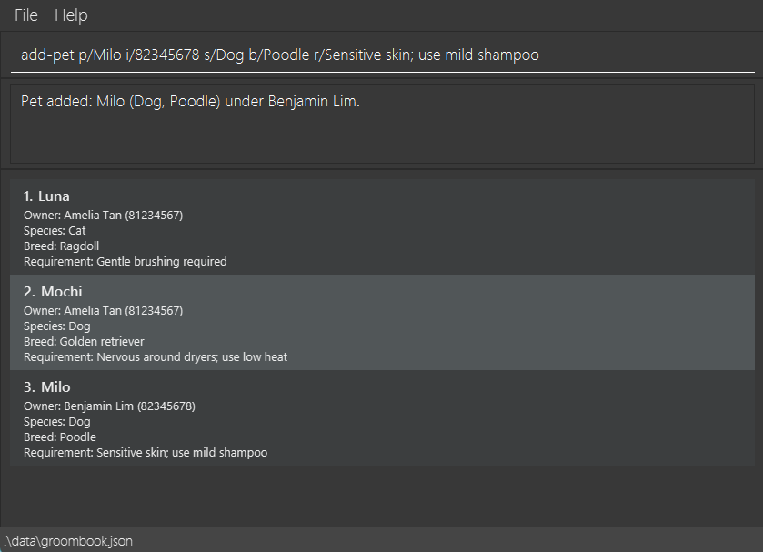

AddressBook Level 3 (AB3) is a **desktop application for managing contacts, optimized for use through a Command Line Interface (CLI)** while retaining the benefits of a Graphical User Interface (GUI). If you type quickly, AB3 can help you manage contacts faster than traditional GUI applications.

* Table of Contents
{:toc}

--------------------------------------------------------------------------------------------------------------------

## Quick start

1. Ensure that Java `25` or later is installed on your computer.<br>
   **Mac users:** Ensure you have the precise JDK version prescribed [here](https://se-education.org/guides/tutorials/javaInstallationMac.html).

2. Download the latest `.jar` file from [here](https://github.com/se-edu/addressbook-level3/releases).

3. Copy the file to the folder you want to use as the _home folder_ for your AddressBook.

4. Open a terminal, `cd` to the folder containing the JAR file, and run `java -jar addressbook.jar`.<br>
   A GUI similar to the one below should appear in a few seconds. Note how the app contains some sample data.<br>
   

5. Type a command in the command box and press Enter to execute it. For example, type **`help`** and press Enter to open the help window.<br>
   Some example commands you can try:

   * `list` : Lists all contacts.

   * `add-client n/John Doe i/98765432 e/johnd@example.com a/John street, block 123, #01-01` : Adds a contact named `John Doe` to the Address Book.

   * `delete-client 3` : Deletes the 3rd contact shown in the current list.

   * `delete-client i/91234567` : Deletes the person with phone number `91234567`.

   * `clear` : Deletes all contacts.

   * `exit` : Exits the app.

6. Refer to the [Features](#features) section below for details of each command.

--------------------------------------------------------------------------------------------------------------------

## Features

<div markdown="block" class="alert alert-info">

**:information_source: Notes about the command format:**<br>

* Words in `UPPER_CASE` are the parameters to be supplied by the user.<br>
  For example, in `add-client n/NAME`, replace `NAME` with a value such as `John Doe`.

* Items in square brackets are optional.<br>
  For example, `n/NAME [t/TAG]` can be used as `n/John Doe t/friend` or as `n/John Doe`.

* Items followed by `…`​ can appear zero or more times.<br>
  For example, `[t/TAG]…​` may be omitted, or written as `t/friend` or `t/friend t/family`.

* Parameters can be in any order.<br>
  For example, if the command specifies `n/NAME i/PHONE_NUMBER`, `i/PHONE_NUMBER n/NAME` is also acceptable.

* Extraneous parameters for commands that take no parameters, such as `help`, `list`, `exit`, and `clear`, are ignored.<br>
  For example, `help 123` is interpreted as `help`.

* If you are using a PDF version of this document, be careful when copying and pasting commands that span multiple lines as space characters surrounding line-breaks may be omitted when copied over to the application.
</div>

### Viewing help: `help`

Shows a message explaining how to access the help page.


Format: `help`


### Adding a client: `add-client`

Creates a booking contact and mobile grooming address. All four fields are required:

* Name: 2-60 characters using letters, spaces, apostrophes, hyphens or full stops.
* Phone: exactly eight digits, starting with 8 or 9, without spaces or hyphens.
* Email: one `@`, no whitespace, and non-empty local and domain parts. The domain must contain a full stop separating non-empty sections.
* Address: 5-120 characters using letters, digits, spaces, commas, full stops, hyphens or `#`.

A phone number or email already used by another client is rejected. Email comparisons are case-sensitive. Clients may share names and addresses. Each required field may appear only once; blank values count as missing. Surrounding whitespace is trimmed.

Success displays `Client added: NAME (PHONE).` and shows the client in the list. A save failure displays `Unable to save client.`; the client remains in memory but may not survive a restart.

Format: `add-client n/NAME i/PHONE_NUMBER e/EMAIL a/ADDRESS [t/TAG]…​`

<div markdown="span" class="alert alert-primary">:bulb: **Tip:**
A person can have any number of tags, including zero.
</div>

Examples:
* `add-client n/John Doe i/98765432 e/johnd@example.com a/John street, block 123, #01-01`
* `add-client n/Betsy Crowe t/friend e/betsycrowe@example.com a/Newgate Prison i/91234567 t/criminal`

### Listing all persons: `list`

Shows a list of all persons in the address book.

Format: `list`

### Editing a person: `edit`

Edits an existing person in the address book.

Format: `edit INDEX [n/NAME] [i/PHONE] [e/EMAIL] [a/ADDRESS] [t/TAG]…​`

* Edits the person at the specified `INDEX`. The index refers to the index number shown in the displayed person list. The index **must be a positive integer** 1, 2, 3, …​
* At least one of the optional fields must be provided.
* Existing values will be updated to the input values.
* When editing tags, all of the person's existing tags are removed; adding tags is not cumulative.
* To remove all of a person's tags, enter `t/` without a tag after it.

Examples:
*  `edit 1 i/91234567 e/johndoe@example.com` Edits the phone number and email address of the 1st person to be `91234567` and `johndoe@example.com` respectively.
*  `edit 2 n/Betsy Crower t/` Edits the name of the 2nd person to be `Betsy Crower` and clears all existing tags.

### Locating persons by name: `find`

Finds persons whose names contain any of the given keywords.

Format: `find KEYWORD [MORE_KEYWORDS]`

* The search is case-insensitive; for example, `hans` matches `Hans`.
* Keyword order does not matter; for example, `Hans Bo` matches `Bo Hans`.
* The search considers only names.
* Only full words match; for example, `Han` does not match `Hans`.
* Persons matching at least one keyword are returned (an `OR` search); for example, `Hans Bo` returns `Hans Gruber` and `Bo Yang`.

Examples:
* `find John` returns `john` and `John Doe`
* `find alex david` returns `Alex Yeoh`, `David Li`<br>
  

### Deleting a person: `delete-client`

Deletes a person from the address book using either their displayed index or phone number.

Formats:

```text
delete-client INDEX
delete-client i/PHONE_NUMBER
```

* `INDEX` must be a positive integer.
* The index refers to the displayed person list.
* `PHONE_NUMBER` must contain exactly 8 digits starting with 8 or 9.
* Provide either an index or a phone identifier, but not both.

Examples:
* `list` followed by `delete-client 2` deletes the 2nd person.
* `find Betsy` followed by `delete-client 1` deletes the 1st search result.
* `delete-client i/91234567` deletes the person with phone number `91234567`.

### Adding a pet to a person: `add-pet`

Adds a pet profile under an existing client, identified by phone number. The current person list does not change.

Format: `add-pet p/PET_NAME i/OWNER_IDENTIFIER s/SPECIES [b/BREED] r/REQUIREMENTS`

* `PET_NAME` must be 1–40 letters, digits, spaces, apostrophes, hyphens, or full stops.
* `OWNER_IDENTIFIER` must be an existing eight-digit phone number starting with `8` or `9`, without spaces or hyphens.
* `SPECIES` must be `Dog`, `Cat`, `Rabbit`, `Guinea Pig`, or `Other` (case-insensitive). `Guinea_Pig` is also accepted.
* `BREED` is optional; if given, it must be 2–50 letters, digits, spaces, apostrophes, hyphens, or full stops.
* `REQUIREMENTS` must be 5–240 characters and cannot contain `/`.
* Each field may appear only once. A client can have several pets, but not two with the same name after ignoring case and
  extra whitespace. Different clients may have pets with the same name.

Examples:

* `add-pet p/Mochi i/87438807 s/Dog b/Golden retriever r/Nervous around dryers`<br>
  Expected: `Pet added: Mochi (Dog, Golden retriever) under Alex Yeoh.`
* `add-pet p/BuBu i/87438807 s/Cat r/Calm with baths`<br>
  Expected: `Pet added: BuBu (Cat) under Alex Yeoh.`

Missing fields report `Missing required field: [field].`; repeated fields report
`Each pet field may be specified only once.` Invalid values or command formats are rejected. An unregistered owner reports
`The owner identifier does not belong to the specified client.` A duplicate pet name under that owner reports
`This client already has a pet named [PET_NAME].` If saving fails, the pet is not added and the app reports
`Unable to save a pet. Please try again.`

### Listing pet profiles: `list-pets`

Shows all saved pet profiles, or only those belonging to the client identified by phone number. The current person
list does not change.

Format: `list-pets [i/OWNER_IDENTIFIER]`

* Without `i/`, pets are grouped by owner, ordered alphabetically by owner name and then pet name. Owners with the same
  name remain in separate groups.
* `OWNER_IDENTIFIER`, if given, must be an existing eight-digit phone number starting with `8` or `9`, without spaces or
  hyphens. Only that client's pets are shown, ordered alphabetically by pet name.
* Each entry shows the pet's name, species, optional breed, and care requirements. A missing breed is omitted.

Examples after adding `Mochi` and `BuBu` under Alex Yeoh:

* `list-pets` displays:

  ```text
  All pet profiles

  Alex Yeoh
  BuBu Cat Calm with baths
  Mochi Dog Golden retriever Nervous around dryers
  ```

* `list-pets i/87438807` displays:

  ```text
  Pets under Alex Yeoh
  BuBu Cat Calm with baths
  Mochi Dog Golden retriever Nervous around dryers
  ```

With no pets saved, `list-pets` displays `No saved pet profiles.` For a client without pets, such as Bernice Yu,
`list-pets i/99272758` displays `Bernice Yu has no saved pet profiles.` A phone number with no saved client reports
`No saved client has this phone number.` Repeating `i/` reports `Each owner identifier may be specified only once.`
An invalid phone number reports `Owner identifier must be a valid phone number belonging to the specified client.`
Unknown fields or extra text report `Invalid command format. Check the command syntax and try again.`

### Deleting a pet: `delete-pet`

Deletes the specified pet from the address book.

Format: `delete-pet p/PET_NAME i/OWNER_IDENTIFIER`

* Both the pet name and its owner's phone number are required to identify the pet.
* The owner phone number must contain at least three digits.

Example:
* `delete-pet p/Milo i/98765432` deletes the pet named `Milo` owned by the person with phone number `98765432`.

### Scheduling an appointment: `add-appointment`

Schedules a grooming appointment for a pet registered under an existing client.

Format: `add-appointment i/OWNER_PHONE p/PET_NAME d/DD-MM-YYYY st/HH:mm et/HH:mm s/SERVICE`

* Use the client's saved phone number and a pet registered under that client. Pet names ignore case and repeated spaces.
* The appointment must start in the future, using Singapore time, and must not overlap another appointment.
* Times use half-hour slots between 08:00 and 20:00, with a duration of at least 30 minutes.
* Services are `Bath and brush`, `Full groom`, `Nail trim`, or `Other`.

Example: `add-appointment i/91234567 p/BuBu d/18-09-2027 st/10:00 et/11:00 s/Full groom`

### Listing appointments: `list-appointments`

Displays ongoing and future grooming appointments in the command result area, ordered by date and start time.
Each entry shows its date, start and end times, pet name, owner phone number, and service.

Format: `list-appointments`

Appointments are included until their end time, using Singapore time. Completed appointments remain saved
but are excluded from this list. If none remain, the command displays `No ongoing or future appointments.`
This command currently takes no parameters; the optional `d/` date filter is not yet supported.

### Clearing all entries: `clear`

Clears all contacts from the address book. Any saved appointments are retained separately.

Format: `clear`

### Exiting the program: `exit`

Exits the program.

Format: `exit`

### Saving the data

Clients, pets, and appointments are saved together in `data/groombook.json` after successful commands.
The app loads this file at startup; you do not need to save manually. Window preferences are stored separately.
Bookings use the same data file as their registered clients and pets.

### Editing the data file

Grooming records are saved in `[JAR file location]/data/groombook.json`, with `clients`, `pets`, and
`appointments` lists. Advanced users can edit this file while the app is closed.

<div markdown="span" class="alert alert-warning">:exclamation: **Caution:**
Back up the file before editing it. If the file becomes invalid, BuBu starts with an empty model and blocks
commands with `Unable to verify existing records. Please contact support.` to avoid overwriting your records.
Correct the file and restart the app before continuing.
</div>

### Archiving data files `[coming in v2.0]`

_Details coming soon ..._

--------------------------------------------------------------------------------------------------------------------

## FAQ

**Q**: How do I transfer my data to another computer?<br>
**A**: Install the app on the other computer and overwrite the data file it creates with the data file from your previous AddressBook home folder.

--------------------------------------------------------------------------------------------------------------------

## Known issues

1. **When using multiple screens**, if you move the application to a secondary screen, and later switch to using only the primary screen, the GUI will open off-screen. The remedy is to delete the `preferences.json` file created by the application before running the application again.
2. **If you minimize the Help Window** and then run the `help` command (or use the `Help` menu, or the keyboard shortcut `F1`) again, the original Help Window will remain minimized, and no new Help Window will appear. The remedy is to manually restore the minimized Help Window.

--------------------------------------------------------------------------------------------------------------------

## Command summary

Action | Format, Examples
--------|------------------
**Add Client** | `add-client n/NAME i/PHONE_NUMBER e/EMAIL a/ADDRESS [t/TAG]…​` <br> e.g., `add-client n/James Ho i/82224444 e/jamesho@example.com a/123, Clementi Rd, 1234665 t/friend t/colleague`
**Delete Client** | `delete-client INDEX` or `delete-client i/PHONE_NUMBER`<br> e.g., `delete-client 3`<br> e.g., `delete-client i/91234567`
**Edit Client** | `edit INDEX [n/NAME] [p/PHONE_NUMBER] [e/EMAIL] [a/ADDRESS] [t/TAG]…​`<br> e.g., `edit 2 n/James Lee e/jameslee@example.com`
**Find** | `find KEYWORD [MORE_KEYWORDS]`<br> e.g., `find James Jake`
**List** | `list`
**Add pet** | `add-pet p/PET_NAME i/OWNER_IDENTIFIER s/SPECIES [b/BREED] r/REQUIREMENTS`<br> e.g., `add-pet p/Mochi i/87438807 s/Dog r/Nervous around dryers`
**List pets** | `list-pets [i/OWNER_IDENTIFIER]`<br> e.g., `list-pets i/87438807`
**List appointments** | `list-appointments`
**Delete pet** | `delete-pet p/PET_NAME i/OWNER_IDENTIFIER`<br> e.g., `delete-pet p/Milo i/98765432`
**Clear** | `clear`
**Add appointment** | `add-appointment i/OWNER_PHONE p/PET_NAME d/DD-MM-YYYY st/HH:mm et/HH:mm s/SERVICE`
**Help** | `help`
